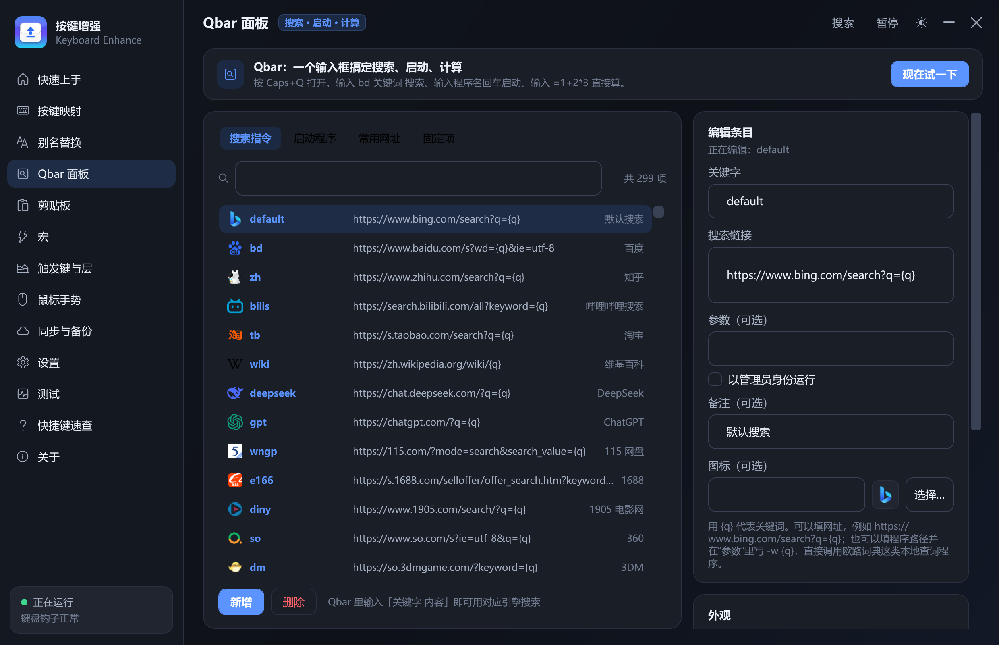
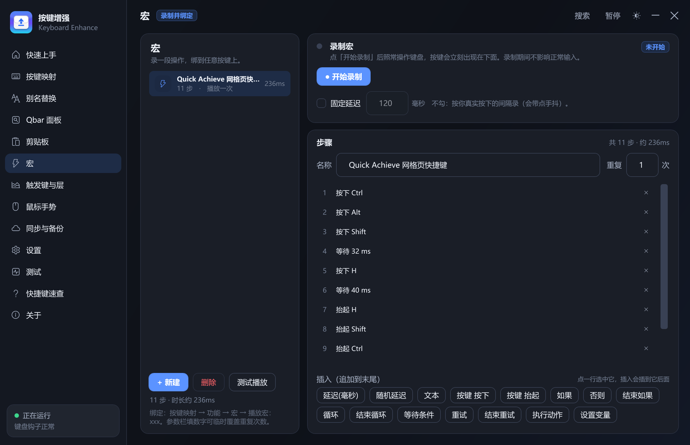
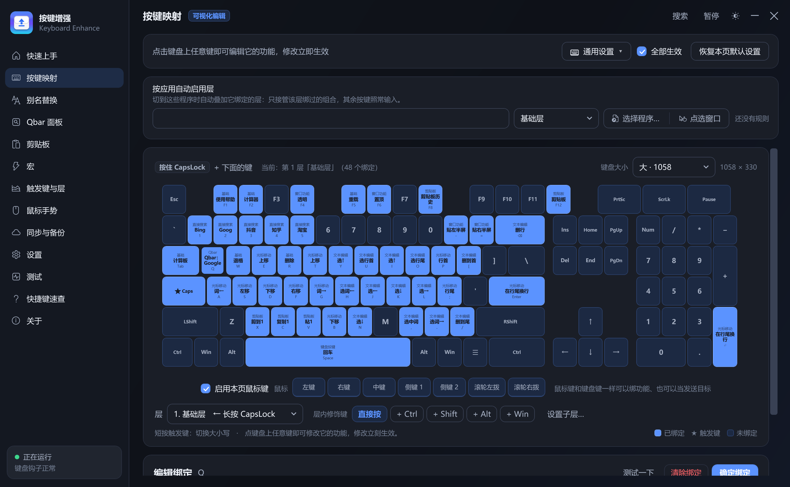

# Keyboard Enhance

> Author: **QQQOrange**
>
> A native Windows 11 desktop rewrite of the AutoHotkey project
> [wo52616111/capslock-plus](https://github.com/wo52616111/capslock-plus).
> Every feature is here, but everything is configured by clicking —
> no more hand-editing `CapsLock+settings.ini`.
>
> The executable is **`KeyboardEnhance.exe`**; user data lives in **`KeyboardEnhance Data`**.
>
> [简体中文](README.md) ｜ **English**

**Version v5.0.1** ｜ **Windows 10 1809+ / Windows 11 (x64 / x86) · Windows 7 SP1 (x64 / x86)** ｜ **Single file: ~2.9 MB on Win10+ (needs the .NET 10 Desktop Runtime) / ~140 MB Win7 / ~130 MB 32-bit (runtime bundled)**

> ### ⚠️ You must install the .NET 10 Desktop Runtime first
>
> The app does **not** bundle the runtime (that is why it is only 2.9 MB). Without it,
> double-clicking does **nothing at all** — no error, no window. Install it first:
>
> **Download**: <https://dotnet.microsoft.com/download/dotnet/10.0>
>
> Pick **.NET Desktop Runtime 10.0.x → Windows → x64**, then click through the installer.
>
> Sanity check: `Desktop Runtime · Windows · x64` (not ASP.NET, not x86).


---

## 1. What it is

In one sentence: **hold CapsLock and the keyboard becomes a different keyboard.**

CapsLock is almost a dead key (its only job is toggling caps). This app turns it into a
*leader key*: hold it and the letter keys, number row, F-keys and more become navigation,
selection, editing, clipboard, window management, launching, math, volume and brightness.
Release it and everything is back to normal.

| Capability | Summary |
| --- | --- |
| Caps combos | Full Caps-combo semantics with **hold-to-repeat**; 10 layers + 10 sub-layers each; **per-device keymaps** (or one shared "generic" map for all devices) |
| Cursor & selection | Character / word / line / page / document movement, the matching selection levels, select current word or line |
| Editing | Delete line, delete to line start/end, change case, wrap selection in symbols, undo/redo alternation |
| Clipboard | Two independent clipboards plus copy history; every entry can be **copied to the system clipboard** |
| Windows | Always-on-top, opacity, minimize/maximize, close, center, 9 snap positions, send to bottom, cycle windows of the same app, activate by screen direction, **per-app window binding** |
| Mouse | Directional movement (hold to accelerate), buttons, wheel, speed steps; **mouse left/right/middle/side 1/side 2 can be remapped and used as send targets** |
| Qbar | One box for search / launch / open URL / math, **299 built-in search engines (298 with built-in icons)**; URL keywords such as `bili` expand into the full address in the box |
| Macros | Record keystrokes into editable steps and bind them anywhere; **keys show on screen while recording**; optional fixed delay for even pacing |
| System | Media keys, volume, brightness, calculator / Explorer / Task Manager, lock screen, screenshot |
| OSD | Volume and brightness bars **pixel-aligned with Windows 11** (see section 11) |
| Data safety | Local data, backups and exports are **AES-256-GCM encrypted** by default; WebDAV sync; GitHub token travels with encrypted backups |
| Updates | Built-in updater (GitHub Releases), resumable retries, SHA-256 verification |

---

## 2. Download & install

### 2.1 Install the .NET 10 Desktop Runtime (once)

Required — see the warning above. Verify from a terminal:

```
dotnet --list-runtimes | findstr WindowsDesktop
:: should list Microsoft.WindowsDesktop.App 10.0.x
```

### 2.2 Pick the right build

Download from [Releases](https://github.com/QQQOrange/Keyboard-enhance/releases) and put the
file in any folder:

| Your system | Download | Runtime |
| --- | --- | --- |
| Windows 11 / Windows 10 1809+, **64-bit** (most PCs) | `KeyboardEnhance.exe` | Requires the .NET 10 Desktop Runtime |
| Windows 10 1809+, **32-bit** | `KeyboardEnhance-5.0.1-x86-Win10-Win11.exe` | Requires the .NET 10 Desktop Runtime (x86) |
| **Windows 7 SP1**, 64-bit | `KeyboardEnhance-5.0.1-x64-Win7-SelfContained.exe` | **No runtime needed** |
| **Windows 7 SP1**, 32-bit | `KeyboardEnhance-5.0.1-x86-Win7-SelfContained.exe` | **No runtime needed** |

> GitHub rewrites non-alphanumeric characters in asset filenames to dots, hence the
> `x86 / x64 / Win7 / SelfContained` suffixes on the release page.

> **About the Windows 7 build**: .NET 10 does not support Windows 7 (minimum is Win10 1809),
> so the Win7 build targets **.NET 7** (the last release supporting Win7 SP1) with the runtime
> bundled — about 140 MB (x64) / 130 MB (x86), but it just runs. Windows must be **SP1**.
> Win11-only visuals degrade gracefully: square window corners (no Mica/rounded corners),
> system-DPI scaling, brightness still works over WMI.

The app creates two folders next to itself on first run:

```
KeyboardEnhance.exe
KeyboardEnhance Data\     user data (encrypted)
KeyboardEnhance Back\     local backups
```

Copy the whole folder and you have moved the app and all of its data.

> **Why only 2.9 MB**: the UI framework and .NET runtime come from the system. You pay with a
> one-time runtime install; you get a tiny binary and fast updates.

### 2.3 Run it

1. The first launch asks for administrator rights — needed to control elevated programs
   (Task Manager, some games). Declining still works, minus elevated windows.
2. A three-step wizard appears: **pick a keymap → autostart? → try it**.
3. The app then lives in the tray. Right-click the tray icon to open settings at any time.

> To quit completely: tray icon → Exit. The window's × only minimizes to the tray.

---

## 3. Three-minute tour

| Goal | Shortcut |
| --- | --- |
| Move cursor left / down / up / right | `Caps+S` / `Caps+D` / `Caps+E` / `Caps+F` |
| Extend selection left / down / up / right | `Caps+J` / `Caps+K` / `Caps+I` / `Caps+L` |
| Open Qbar | `Caps+Q` |
| Copy to the standalone clipboard | `Caps+C`, paste with `Caps+V` |
| Open the calculator | `Caps+F2` |
| Switch windows (once bound) | `Caps+1` … `Caps+0` |

**Hold `Caps+S` and the cursor keeps moving left** — that is what makes it nicer than arrow keys.

---

## 4. Core concepts: trigger keys and layers

**Trigger keys** are the leader keys. The default is `CapsLock`, but any key can be used
(right Ctrl, an unused F-key…), several triggers can coexist, each with its own layers,
hold threshold and tap action. Managed on the *Trigger keys & layers* page.

**Layers** are alternate keymaps while a trigger is held: **10 layers**, each with up to
**10 sub-layers** (hold another key inside a layer to switch temporarily).

| Concept | Meaning |
| --- | --- |
| Layer | 10 layers, each a full keymap; switch the edited layer at the top of *Key mapping* |
| Sub-layer | Up to 10 per layer: hold a key inside the layer to enter it |
| Hold threshold | How long the trigger must be held to "enter" the layer (default 200 ms), configurable per trigger |
| Tap action | Behaviour below the threshold: toggle caps (default), Esc, Qbar, keep original, none… |
| Double-tap action | Press the trigger twice quickly (Qbar by default); can be disabled |
| Keymap preset | Two built-ins: `capslox` (default) and `capslock_plus` (pre-3.0 layout), chosen on first run |

Layers and triggers are fully editable in the UI and take effect immediately.

### The replacement layer: no trigger at all

A replacement layer has **no trigger key**. Whatever key you put in it executes its action
whenever pressed normally. It is the last entry in the layer dropdown on *Key mapping*.

| You configure | Pressing it does |
| --- | --- |
| Space → digit 1 | Space types `1` |
| Middle mouse → a shortcut | Clicking the wheel runs that shortcut |
| F9 → disable this key | F9 is swallowed (handy to kill a key) |
| Side button 1 → text snippet | Pastes that text |

Three rules:

- **It wins over normal layers**: the same key in a replacement layer and a normal layer —
  the replacement layer wins, because it needs no precondition.
- **It can be per device**: with a device selected in the device pill, the replacement only
  applies to that device; switch back to *Generic settings* for all devices.
- **"Not bound" ≠ "disabled"**: *not bound* means no rule and the key passes through
  (games, AutoHotkey etc. still see it); only *disable this key* swallows it.
  To undo, delete the binding row (or *Restore this page's defaults*).

### Per-keyboard, per-mouse keymaps

The device pill at the top right of *Key mapping* (default: **Generic settings**):

| Element | Effect |
| --- | --- |
| The pill itself | Chooses who you are editing for: *Generic* applies everywhere; a specific device applies only to it |
| Checkbox per device | Whether this app manages that device at all (unchecked = completely untouched, not even the trigger) |
| *Enable all* | Turns every attached device on; unchecking one turns it off automatically |

Keys not defined for a device **inherit the generic map**; to make a keyboard fully
independent, use *Settings → Base remap* and give it its own scheme.
*Restore this page's defaults* in device mode only clears that device's layer.

Mice are remappable too: left, right, middle, side 1, side 2 sit under the keyboard, usable
as sources, as send targets, and inside Caps combos (e.g. `Caps` + middle click → Qbar).

### Per-app layers

*Key mapping → Automatically enable a layer for these apps*: add a process name
(or pick a running window with the crosshair). While that program is in the foreground its
layer is overlaid; keys it does not define keep behaving normally.

---

## 5. All default shortcuts

> Defaults of the `capslox` scheme. Everything is rebindable on *Key mapping*.

### Cursor

| Key | Action | Key | Action |
| --- | --- | --- | --- |
| `Caps+S` | Left one character | `Caps+D` | Down one line |
| `Caps+E` | Up one line | `Caps+F` | Right one character |
| `Caps+A` | Left one word | `Caps+G` | Right one word |
| `Caps+P` | Line start | `Caps+;` | Line end |
| `Caps+B` / `Caps+T` | Down / up 10 lines | `Caps+Enter` | Newline at line end |

### Selection

| Key | Action | Key | Action |
| --- | --- | --- | --- |
| `Caps+J` / `Caps+L` | Extend left / right | `Caps+I` / `Caps+K` | Extend up / down |
| `Caps+H` / `Caps+O` | Select to line start / end | `Caps+N` | Extend 10 lines down |
| `Caps+,` | Select current word | `Caps+.` | Extend one word right |

### Editing

| Key | Action |
| --- | --- |
| `Caps+R` / `Caps+W` | Delete / backspace |
| `Caps+Backspace` | Delete the whole line |
| `Caps+[` / `Caps+/` | Delete to line start / end |
| `Caps+LAlt+Backspace` | Clear the content |

### Clipboard (two independent clipboards)

| Key | Action |
| --- | --- |
| `Caps+C` / `Caps+X` / `Caps+V` | Copy / cut / paste clipboard 1 |
| `Caps+LAlt+C` / `Caps+LAlt+X` / `Caps+LAlt+V` | Clipboard 2 |
| `Caps+F12` | Toggle the standalone clipboard |
| `Caps+F8` | Clipboard history |

The standalone clipboards never touch the system clipboard, so you can copy A, copy B,
then paste each separately.

### Windows

| Key | Action |
| --- | --- |
| `Caps+F6` | Toggle always-on-top |
| `Caps+F4` | Cycle window opacity |
| `Caps+-` | Snap left half |
| `Caps+=` | Snap right half |
| `Caps+1` … `Caps+0` | **Unbound by default**: bind them to *Window binding → some program* |

### Mouse

| Key | Action |
| --- | --- |
| `Caps+arrows` (bind yourself) | Move the pointer, hold to accelerate |
| Bindable | Left / right click, wheel up / down, speed up / down |
| Bindable | **Wheel tilt left / right** (tilt wheels, touchpad horizontal swipes) |

Pointer step size is configured in *Settings* (default 10 px).

### Panels and tools

| Key | Action |
| --- | --- |
| `Caps+Q` | **Qbar**: search / launch / open URL / math |
| `Caps+Tab` | Evaluate the expression before the caret, or expand a hotstring |
| `Caps+F2` | Calculator with history |
| `Caps+F5` | Reload configuration |
| `Caps+F1` | Help |

`Caps+LAlt+arrows` switch windows and `Caps+LAlt+A~G` activate windows by screen position;
the in-app *Shortcut reference* page lists everything.

### System actions (bind under *Key mapping → System*)

| Action | Notes |
| --- | --- |
| Play/pause, previous, next, stop | Media keys for the current player |
| Volume + / − / mute | Sends **system volume keys** so Windows shows its own OSD (no duplicate bar); step size configurable (default 5%), per-binding override, hold to repeat |
| Brightness + / − | WMI for internal panels, DDC/CI for external monitors; the OSD at the bottom centre **matches the Windows 11 brightness bar** (section 11); step size configurable (default 10%), hold to repeat |
| Calculator / Explorer / Task Manager | Common tools |
| Lock screen / screenshot | Win+L / Snipping Tool |

---

## 6. Every action you can bind

The action dropdown is grouped into **17 categories**:

| Category | Actions |
| --- | --- |
| Basics | None, toggle caps, keep original key, open settings, enable/pause, Qbar, calculator, Tab-evaluate, help, reload config (`Esc`/`Enter`/`Tab`/`Space`/`Backspace`/`Delete` are recognised but live under *Keyboard keys*) |
| Keyboard keys | One action per physical key: letters, digits, F1–F24, editing/navigation, symbols, numpad, `Esc`/`Tab`/`Delete`/`PrintScreen` and so on |
| Cursor | Left/right/up/down, word left/right, line start/end, document start/end, page up/down, scroll one line, newline at end |
| Text editing | Delete line, delete to line/document start/end, delete word, wrap selection, clear, undo/redo, upper/lower/title case, plus all selection variants |
| Clipboard | Copy/cut/paste to clipboard 1 and 2, paste the system clipboard, toggle the standalone clipboard, history |
| Qbar search | Open Qbar with a specific engine |
| Direct search | Search the selected text with a chosen engine in the default browser, without opening Qbar (all 299 engines, filterable) |
| Window | **Window binding (switch / minimize / launch)**, topmost, opacity, minimize, maximize, close, center, 9 snaps, send to bottom, next/previous window of the same app, activate the window on a screen side |
| Mouse | Move, left/right/middle/side 1/side 2, wheel up/down, tilt left/right, speed + / − |
| System | Media keys, volume, brightness, calculator / Explorer / Task Manager, lock, screenshot |
| Smart open | Opens whatever is selected — URL, folder or file; with no selection it uses the newest clipboard entry; does nothing otherwise |
| Direct link | Open a preconfigured URL / folder / file, with an optional note shown on the keycap |
| Send to app | Send a key to a specific program, launching it first if needed |
| Type text | Types preset text at the caret, character by character over Unicode, without touching the clipboard (works with IMEs and emoji) |
| Macro | One action per macro (play N steps) plus *manage macros* |

---

## 7. Qbar: one box for most things

Open with `Caps+Q`.



### Keywords become chips

Type `bd` and press **Space**; `bd` turns into a chip:

- **Icon if available** (Baidu, Google, GitHub… built-in vectors, offline)
- **Otherwise name + brand-coloured initial**

The box then holds only the query:

```
[🔵 Baidu]  weather forecast   →  Enter  →  search with Baidu
```

- `Backspace` on an empty box turns the chip back into text
- The `×` on the chip removes it; `Tab` also makes a chip
- Math (`=1+2*3`) still works in chip mode

### URL keywords fill in the whole address (v5.0)

URL keywords such as `bili` live in the *Websites* table, not the search-engine table, so
Space does not create a chip — it writes the address into the box:

```
bili + Space  →  https://www.bilibili.com
```

The hint reads *Enter to open the URL* and Enter opens it in the browser. Keep typing to
change the site; a complete URL in the box is always "open this", never a search term.

### Input cheatsheet

| Input | Result |
| --- | --- |
| `bd` + Space + `weather` | Baidu chip, searches "weather" |
| `calc` + Space | Calculator chip, Enter launches it |
| `bili` + Space | Box becomes `https://www.bilibili.com`, Enter opens it |
| `gh` + Space | GitHub chip, Enter opens it |
| `=1+2*3` | Shows `7`, Enter copies it |
| `/settings` | Opens settings |
| `C:\path\to\file` | Opens the file or folder |
| Any text | Enter searches with the default engine |

`↑` `↓` select, `Enter` runs, `Tab` completes, `Esc` closes. Programs, URLs, search commands,
clipboard history and open windows all participate.

### Built-in commands

`/settings`, `/bindings`, `/clipboard`, `/help`, `/math`, `/reload`, `/pause`, `/exit`.

### Built-in engines (299, 298 with icons)

Engines can also be used inline: `bd weather`. Add your own under *Qbar → Search commands*.
The engine table is versioned: new built-ins are merged on startup without touching your edits.

### Where icons come from

1. The icon you set on the *Qbar* page (png / ico / any exe)
2. For programs, the executable's own icon
3. Otherwise a rounded tile with the initial and the brand colour

Website icons are cached on disk under `KeyboardEnhance Data/icons/web/`, prewarmed at
startup, so the *Websites* page shows real icons immediately — no "initial, then refresh".

---

## 8. Window binding

**One key = one program.** Press it: launch if not running, focus if running, minimize if
already focused.

1. Click the key you want (e.g. `1`)
2. Choose category *Window*, action *Switch window*
3. Pick the program either by **file** (works even when it is not running) or with the
   **crosshair** (hover highlights windows and shows titles, `Esc` cancels)


The keycap shows the program icon and name; rename it if `idea64.exe` is not obvious.
The old ten fixed window slots are gone — bind as many as you like, wherever you like.
Turn off *Settings → Key behaviour → Animate window switching* if you dislike the animation.

---

## 9. Macros

Record keystrokes (which keys, how long apart), edit the resulting steps, bind the macro to
any key. Recorded keys appear on screen while recording; steps can be edited, deleted and
retimed. Macros show up automatically in the action list.

- Optional **fixed delay** (default 120 ms) for even playback
- Minimum step gap 15 ms
- Repeat count can be overridden per binding
- Remote-desktop tools (RDP, Sunlogin, ToDesk) work too: recording also listens to Raw Input
  and de-duplicates the two paths at millisecond precision



---

## 10. Text snippets

Type a trigger word and it expands into preset content — e-mails, addresses, signatures,
code blocks, ticket templates. Add them under *Settings → Text snippets*.

```
type ;mail  →  someone@example.com
```

- Triggers must **start with a symbol** (`;` `/` `.` …), never a letter or digit
- They only fire **at word start**, and are **case-sensitive**
- Optional per-program scope: process names, a picked exe, or the crosshair
- Live preview tells you what a trigger expands to, or why it did not match
- Enable/disable per row; click a row to edit it
- The trigger symbol is chosen from a pill of eight half-width symbols; existing entries
  migrate automatically
- Full-width and half-width forms match each other (IME-friendly)
- Chinese triggers work as long as they do not start with an ASCII letter/digit
- A shorter trigger yields to a longer candidate for 120 ms, so `;m` does not steal `;mail`

**Lost aliases?** *Find lost aliases* on the snippets page scans `.bak`, pre-upgrade copies
and the daily snapshots (`KeyboardEnhance Data/backups/settings-YYYYMMDD.json`, last 30) and
offers entries that are missing from the current configuration. Existing triggers are never
overwritten. `KeyboardEnhance.exe --dump-snippets [file]` prints the same information.

---

## 11. Volume and brightness OSDs

**Volume** sends the system volume keys, so Windows draws its own bar — never two bars at once.

**Brightness** uses WMI for internal panels and DDC/CI for external monitors (enable DDC/CI in
the monitor menu). The bar appears bottom-centre and matches the Windows 11 brightness OSD in
size, spacing, colours, icon and animation, including the hand-drawn sun. Step size defaults
to 10% and can be overridden per binding; hold to repeat.

---

## 12. The UI

| Page | Purpose |
| --- | --- |
| Quick start | Status, keymap preset, three-step guide |
| Key mapping | Click any key on the keyboard and edit it below (v4.30.0+: pick an action, then *Confirm*); four keyboard sizes; layers, sub-layers, per-app layers, device pill; one magnifier search box next to the title that finds bound keys *and* all actions (v5.0) |
| Aliases | Text snippets |
| Qbar | Search commands, programs, websites, appearance and icons |
| Clipboard | Both clipboards, recent history |
| Macros | Record, edit, bind |
| Trigger keys & layers | Triggers, thresholds, tap actions, 10 layers and their sub-layers |
| Sync & backup | WebDAV, backup list, import/export, startup password lives under Settings |
| Settings | Autostart, tray, tap behaviour, repeat, animations, feedback, mouse, volume/brightness steps, theme, language (Chinese / English, instant), startup password, snippets, base remap |
| Test | Live hook status, current layer, recent keys, matched actions, diagnostics |
| Shortcut reference | Every active combo by category, filter box with magnifier, empty state, **Copy sheet** to Markdown |
| About | Version, GitHub, auto-update, check updates, plus a *Help & feedback* card (docs, changelog, issues, open data/log folder, copy diagnostics) |

Light / dark / follow-system themes; Win11 rounded corners and Mica.



### When something does not work, open *Test*

It shows whether the hook is alive, whether the trigger is recognised, the current layer and
what the last key resolves to, and can copy a diagnostic report.

---

## 13. Data, backup, sync and migration

| Content | Location |
| --- | --- |
| User data | `KeyboardEnhance Data\settings.json` (encrypted), `vault.json`, `icons\`, `logs\` |
| Local backups | `KeyboardEnhance Back\KeyboardEnhance(<time>).keyboardenhance` |

When installed somewhere read-only (e.g. `Program Files`) data falls back to
`%LocalAppData%\KeyboardEnhance`; the *Sync & backup* page shows the actual path. Data from
`%LocalAppData%\CapsLockPlus` is migrated on first run, keeping the old folder.

- **Local backups**: keep the last 10, optional automatic backup (60 min), restore by
  overwrite or merge
- **WebDAV sync**: on startup / on exit / on a timer, three independent switches
- **Import/export**: `.clpconf` exports; `.keyboardenhance` backups are importable too
- **Encryption**: backups and exports are AES-256-GCM by default; only an explicit plaintext
  export drops password fields and the GitHub token
- **GitHub token** travels with encrypted backups and sync, so a new machine does not need it

### Startup password vs backup password

| | Startup password | Backup password |
| --- | --- | --- |
| Guards | Who may open the app | Backup files and local data |
| Configured in | Settings toggle | Sync & backup page |
| Stored in | `startup.json` in the data folder | Inside encrypted settings |
| Forgotten | Delete `startup.json` | Backups stay locked |

Only a PBKDF2-HMAC-SHA256 derivation (600,000 iterations, random salt) is stored — no
plaintext. The password file is independent of `settings.json`, is not exported, and survives
*Reset all settings*.

### Migrating from classic CapsLock+

*Settings → Import from CapsLock+*, pick the old `CapsLock+settings.ini`: `[Keys]` entries map
to actions with parameters, `[QSearch]` / `[QRun]` / `[QWeb]` / `[TabHotString]` are imported,
`autostart`, `mouseSpeed` and `allowClipboard` come along. Anything that cannot be mapped is
listed for manual confirmation.

---

## 14. Updates

*About* has two entry points:

- **Auto-update toggle**: silently checks once a day at most, asks before downloading,
  downloads in place, replaces the executable and restarts. Skip a version if you like;
  the next one still notifies.
- **Check for updates**: immediate check showing version, size and notes.

The updater downloads into the data folder, verifies SHA-256 when provided, renames the old
binary, installs the new one and restarts; leftovers are cleaned on the next launch. It uses
its own HTTP client (5-minute timeout, up to 3 retries) for flaky networks.

> For maintainers: the updater reads the latest GitHub Release, so tag releases as `vX.Y.Z`
> and attach the `.exe` assets.

---

## 15. Differences from upstream

Kept: all Caps-combo semantics, both keymap presets, Qbar search/launch/math, standalone
clipboards, window binding, Tab evaluation and hotstrings.

| Aspect | Upstream (AutoHotkey) | This project |
| --- | --- | --- |
| Configuration | Hand-edited UTF-16 ini | GUI + JSON, applied instantly |
| Math | IE engine running JS | Built-in expression parser, works without IE |
| Hook stability | May be unhooked after long uptime | Watched every second and reinstalled automatically |
| Key latency | Actions run inside the hook | Hook only classifies, actions run on a worker queue |
| Clipboard watching | Timer polling | `WM_CLIPBOARDUPDATE`, zero idle CPU |
| Search keywords | Plain text | Chips with icons |
| Updates | Manual download | Built-in updater |
| Privacy | Plaintext ini | Local data, backups and exports AES-256-GCM by default |
| Troubleshooting | Read logs and guess | *Test* page shows keys, layers and actions live |
| Startup | — | ~0.6 s to first paint |

---

## 16. FAQ

**Double-clicking does nothing.** The .NET 10 Desktop Runtime is missing — see the top of
this file.

**Shortcuts stopped working after a while.** The *Test* page shows whether the hook is alive;
the app reinstalls a dropped hook automatically. Corporate security software that blocks
low-level hooks is the usual culprit.

**Some windows ignore the shortcuts.** Elevated windows need the app to run elevated; accept
the UAC prompt (or run it as administrator).

**`Caps+1`…`Caps+0` do nothing.** They are intentionally unbound: bind each to a program under
*Window binding*.

**Where is my data?** `KeyboardEnhance Data` next to the executable, or
`%LocalAppData%\KeyboardEnhance` when that folder is read-only.

**How do I uninstall?** Quit from the tray, delete the executable and the two data folders.
Nothing is written to the registry except the optional autostart entry.

**Can I use it on Windows 7?** Yes, with the self-contained Win7 build (SP1 required).

**Does it conflict with AutoHotkey?** Both can hook the keyboard; Caps combos are consumed by
whichever hooks first. Disable the overlapping hotkeys in one of them.

---

## 17. Build from source

Requires the **.NET 10 SDK**. See [BUILD.md](BUILD.md).

```powershell
# Release all four flavours (x64/x86 × Win10/Win7) + hashes + notes
powershell -ExecutionPolicy Bypass -File tools\release.ps1

# All command-line switches
dist\KeyboardEnhance.exe --help

# Self-test: ~3920 checks (varies slightly by system environment) (key model, expressions, Qbar, chips, migration, hooks,
# combo state machine, OSD ratios, localisation, snippets, popups, window cache, UIA, shutdown)
dist\KeyboardEnhance.exe --selftest

# Hook-chain diagnostics (injects an F24 probe, 6/6 expected)
dist\KeyboardEnhance.exe --diag

# Off-screen render of every page (docs / regression; 46 images)
dist\KeyboardEnhance.exe --render docs\screenshots
```

| Switch | Purpose |
| --- | --- |
| `--selftest` | Run the self-test (exit code 0 = pass), log in `selftest.log` |
| `--render <dir>` | Render every page to PNG off-screen |
| `--render-diag` | Render with layout metrics and untranslated-string audit |
| `--diag` | Hook-chain diagnostics (self-injection + 11 checks) |
| `--hwtest` | Hardware pass: volume, system volume keys, brightness (restored afterwards) |
| `--osd [percent]` | Show the OSD once |
| `--osd-hold <ms>` | OSD dwell time |
| `--pick-test <file>` | Window-picker test while elevated |
| `--page=<name>` | Start on a page (`guide` `keys` `qbar` `clipboard` `macros` `layers` `backup` `settings` `test` `help` `about`) |
| `--trace` | Log every key the hook sees |
| `--svg2png` | Dump built-in SVG icons as PNG |
| `--help` | Print this table (writes `usage.txt` in the data folder) |

The project multi-targets `net10.0-windows;net7.0-windows` from one source tree: the net7 leg
locks C# 11, uses System.Management 8.0.0 and `app-win7.manifest`. A few .NET 8+ conveniences
are written in a form both targets compile, so behaviour never diverges.

```
src/CapsLockPlus/
├─ Core/                  UI-free engine (self-testable headless)
│  ├─ Input/              Hook, Caps state machine, key names, injection
│  ├─ Actions/            Action catalogue, context, clipboard, window binding
│  ├─ Windows/            Enumeration / activation / snapping / topmost / opacity, volume, brightness, OSD layout
│  ├─ Text/               Selection access, expression evaluator
│  ├─ Qbar/               Query pipeline and chips
│  ├─ Icons/              Icon cache, minimal SVG renderer
│  ├─ Macro/              Recording and playback
│  ├─ Settings/           JSON settings, ini migration, autostart
│  ├─ Sync/               WebDAV, crypto, import/export, backup merge
│  └─ Update/             Check / download / replace
├─ UI/                    WPF
│  ├─ Windows/            Main window, Qbar, calculator, wizard, toast, update prompt, OSD
│  ├─ Views/              12 pages
│  ├─ Theme/              Themes, Win11 window chrome
│  └─ AppHost.cs          Composition root
├─ Theme/                 Palettes and control templates
└─ SelfTest.cs            Self-test
```

Design notes:

- The hook callback **only classifies**; work is queued to `ActionQueue`, staying far below
  the 300 ms `LowLevelHooksTimeout`
- Injected keys carry a `dwExtraInfo` marker so the hook ignores its own output
- Pages are created on demand and cached
- No `DropShadowEffect`: WPF would render content into an intermediate bitmap
- Theme colours are `DynamicResource`, so open windows restyle instantly
- A new action is one line in `Core/Actions/ActionCatalog.cs`; the mapping page and the
  shortcut reference pick it up automatically

---

## 18. Performance

| Metric | Measured |
| --- | --- |
| First paint | ~0.6 s |
| Idle CPU | 0 % |
| Tray footprint | ~60 MB private |
| Executable | 2.9 MB (single file, framework-dependent) |
| Self-test | ~3920 checks, all passing |

The hot path is micro-optimised because the hook has a hard 300 ms budget: trigger matching
uses a cached `HashSet<int>`, layer lookup a prebuilt case-insensitive dictionary, and layer
key lists are reused instead of reallocated.

---

## 19. License

Upstream CapsLock+ is GPL-3.0; this derivative is **GPL-3.0** as well. See [LICENSE](LICENSE).
The upstream sources are kept in `upstream/` for reference.
