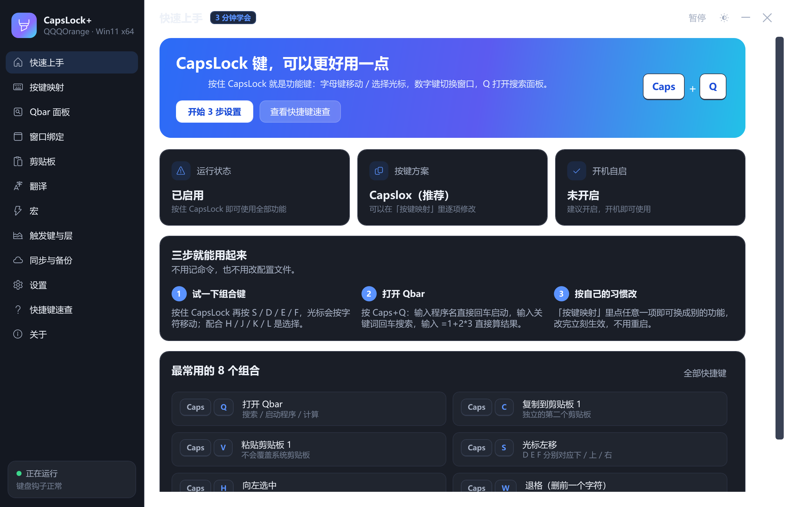
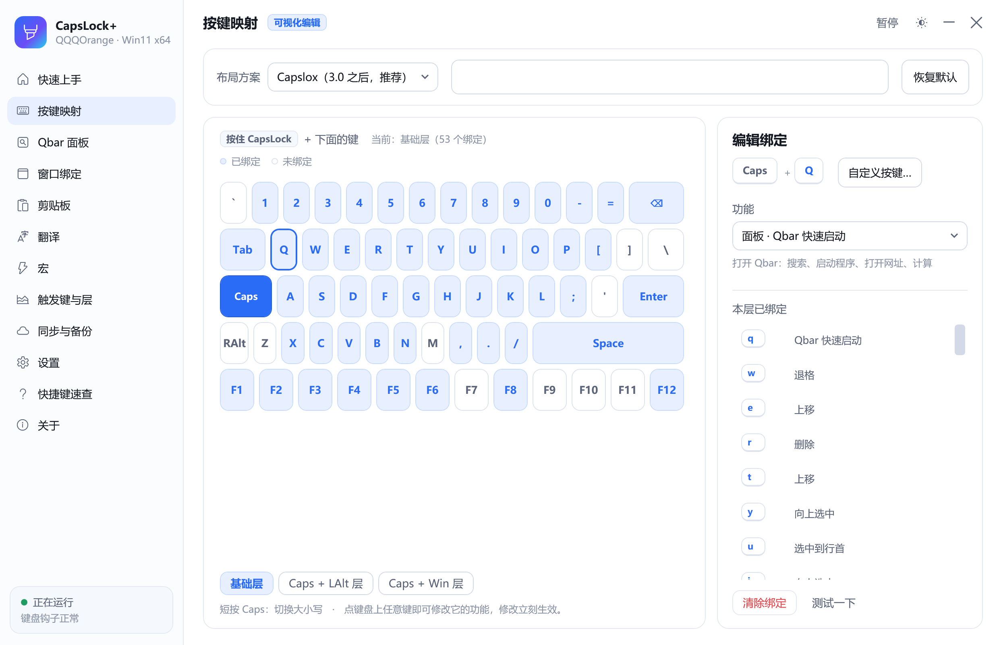

# CapsLock+（QQQOrange）

> 把 [wo52616111/capslock-plus](https://github.com/wo52616111/capslock-plus) 的 AutoHotkey 脚本，
> 重写成**原生 Windows 11 桌面程序**：功能一个不少，但所有设置都能在图形界面里点点点完成，
> 再也不用去手改 `CapsLock+settings.ini`。

**版本 v1.3.1** ｜ **Windows 10 1809+ / Windows 11 · x64** ｜ **单文件 2.39 MB**



---

## 一、下载与安装

### 1. 装运行时（只需一次）

程序依赖 **.NET 10 桌面运行时**，它**不在本仓库里**，请到微软官网下载安装：

> **下载页面**：<https://dotnet.microsoft.com/download/dotnet/10.0>
>
> 在页面里找到 **.NET 10.0 → Desktop Runtime**，选择 **Windows x64**，
> 也就是列表中的这一项：
>
> `Desktop Runtime 10.0.x — Windows — x64`
>
> 下载后双击安装，一路“下一步”即可。

如果你不确定该装哪个：**Windows → x64 → Desktop Runtime**，这三个词对上就没错。

### 2. 拿到程序

两种方式任选：

- **直接下载**：到本仓库的 [Releases](https://github.com/QQQOrange/capslock-plus-QQQOrange-/releases)
  页面，下载最新版本的 `CapsLockPlus.exe`。
- **自己编译**：见文末「开发与构建」。

### 3. 运行

双击 `CapsLockPlus.exe`：

1. 首次运行会请求管理员权限 —— 这是为了能操作那些“以管理员身份运行”的程序（任务管理器、部分游戏等）。
   如果你不想给，点“否”也能用，只是管不了提权窗口。
2. 会出现三步引导：**选按键方案 → 是否开机自启 → 试一下**。
3. 之后程序常驻托盘（右下角），右键托盘图标可随时打开设置。

> 想彻底退出：右键托盘图标 → 退出。点窗口右上角的 × 只是最小化到托盘。

---

## 二、3 分钟上手

| 想做什么 | 怎么按 |
| --- | --- |
| 光标左移 / 下移 / 上移 / 右移 | `Caps+S` / `Caps+D` / `Caps+E` / `Caps+F` |
| 向左 / 下 / 上 / 右选中 | `Caps+J` / `Caps+K` / `Caps+I` / `Caps+L` |
| 打开搜索面板 | `Caps+Q` |
| 复制到独立剪贴板 | `Caps+C`，粘贴用 `Caps+V` |
| 打开计算器 | `Caps+F2` |
| 切换窗口（先绑定过） | `Caps+1` ~ `Caps+0` |

**长按 `Caps+S` 不松手，光标会连续左移** —— 这是它比方向键更顺手的地方。

---

## 三、全部快捷键

### 光标移动（按住 Caps）

| 按键 | 作用 | 按键 | 作用 |
| --- | --- | --- | --- |
| `Caps+S` | 左移一个字符 | `Caps+D` | 下移一行 |
| `Caps+E` | 上移一行 | `Caps+F` | 右移一个字符 |
| `Caps+A` | 左移一个单词 | `Caps+G` | 右移一个单词 |
| `Caps+P` | 行首 | `Caps+;` | 行尾 |
| `Caps+B` / `Caps+T` | 下移 / 上移 10 行 | `Caps+Enter` | 在行尾换行 |

### 选择文本

| 按键 | 作用 | 按键 | 作用 |
| --- | --- | --- | --- |
| `Caps+J` / `Caps+L` | 向左 / 向右选中 | `Caps+I` / `Caps+K` | 向上 / 向下选中 |
| `Caps+H` / `Caps+O` | 选中到行首 / 行尾 | `Caps+N` | 向下选中 10 行 |
| `Caps+,` | 选中当前单词 | `Caps+.` | 向右选中一个单词 |

### 编辑

| 按键 | 作用 |
| --- | --- |
| `Caps+R` / `Caps+W` | 删除 / 退格 |
| `Caps+Backspace` | 删除整行 |
| `Caps+[` / `Caps+/` | 删除到行首 / 行尾 |
| `Caps+LAlt+Backspace` | 清空内容 |

### 剪贴板（两个互不干扰的独立剪贴板）

| 按键 | 作用 |
| --- | --- |
| `Caps+C` / `Caps+X` / `Caps+V` | 复制 / 剪切 / 粘贴到剪贴板 1 |
| `Caps+LAlt+C` / `Caps+LAlt+X` / `Caps+LAlt+V` | 剪贴板 2 |
| `Caps+F12` | 开 / 关独立剪贴板 |
| `Caps+F8` | 剪贴板历史 |

独立剪贴板不占用系统剪贴板，所以可以“复制 A、再复制 B，然后分别粘贴”。

### 窗口

| 按键 | 作用 |
| --- | --- |
| `Caps+F6` | 窗口置顶 / 取消 |
| `Caps+F4` | 窗口透明度循环 |
| `Caps+1` … `Caps+0` | 切到窗口槽位 1~10 |
| `Caps+LAlt+1` … `Caps+LAlt+0` | 把当前窗口绑定到槽位 |

连续按两次同一个 `Caps+LAlt+数字`，可把多个窗口加进同一槽位，之后反复按 `Caps+数字` 循环切换；
连按三次则绑定该程序的**所有**窗口（新开的窗口会自动加入）。

### 面板与工具

| 按键 | 作用 |
| --- | --- |
| `Caps+Q` | **Qbar**：搜索 / 启动程序 / 打开网址 / 计算 |
| `Caps+Tab` | 把光标前的算式算出结果，或展开热字串 |
| `Caps+F2` | 计算器（带历史记录） |
| `Caps+F3` | 翻译选中文本 |
| `Caps+F5` | 重新加载配置 |
| `Caps+F1` | 打开帮助 |

还有 `Caps+LAlt+方向` 切换窗口、`Caps+LAlt+A~G` 按屏幕方位激活窗口等经典布局快捷键，
详见程序内「快捷键速查」页。

---

## 四、Qbar：一个输入框搞定大部分事

按 `Caps+Q` 打开。

### 关键字会变成「标签」

输入 `bd` 再按 **空格**，`bd` 就从文字变成一枚标签：

- **有图标 → 显示图标**（例如百度、Google、GitHub，内置矢量图标，离线可用）
- **没有图标 → 显示「名字 + 品牌色首字」**（例如计算器显示橙底「计」）

变成标签后，输入框里只剩**要搜索的内容**，输入完回车即可：

```
[🔵 百度]  天气 预报        →  Enter  →  用百度搜索「天气 预报」
```

- 输入框为空时按 `Backspace`，把标签还原成文字，方便改关键字
- 点标签右边的 `×` 也能移除
- `Tab` 键同样能把关键字变成标签
- 标签模式下仍然支持 `=1+2*3` 直接计算

### 输入规则一览

| 输入 | 结果 |
| --- | --- |
| `bd` + `空格` + `天气` | 变成「百度」标签，搜「天气」 |
| `calc` + `空格` | 变成「计算器」标签，回车启动 |
| `gh` + `空格` | 变成「GitHub」标签，回车打开 |
| `=1+2*3` | 立刻算出 `7`，回车复制到剪贴板 |
| `/settings` | 打开设置 |
| `C:\path\to\file` | 打开该文件 / 文件夹 |
| 任意文字 | 回车用默认搜索引擎搜索 |

`↑` `↓` 选择，`Enter` 执行，`Tab` 补全，`Esc` 关闭。
程序、网址、搜索指令、剪贴板历史、已打开的窗口都会参与匹配。

### 内置引擎（306 个，全部带图标）

关键字按统一约定命名：**国内引擎用拼音首字母，国外引擎用英文前两个字母**。

| 国内引擎（拼音首字母） | 关键字 | | 国外引擎（英文前两字母） | 关键字 |
| --- | --- | --- | --- | --- |
| 百度 | `bd` | | Google | `go` |
| 淘宝 | `tb` | | Bing | `bi` |
| 知乎 | `zh` | | GitHub | `gh` |
| 哔哩哔哩 | `bili` | | Wikipedia | `wi` |
| 微信 | `wx` | | YouTube | `yo` |
| 微博 | `wb` | | Reddit | `re` |
| 京东 | `jd` | | Stack Overflow | `st` |
| 小红书 | `xhs` | | MDN | `md` |
| 抖音 | `dy` | | Amazon | `am` |
| 豆瓣 | `db` | | X (Twitter) | `tw` |
| CSDN | `csdn` | | Facebook | `fa` |
| 掘金 | `juejin` | | npm | `np` |
| Gitee | `gitee` | | NuGet | `nu` |
| 拼多多 | `pdd` | | 翻译 | `tr` |
| 腾讯视频 | `tx` | | | |
| 爱奇艺 | `iqy` | | | |

**第二批补充（共 18 个）**

| 引擎 | 关键字 | 引擎 | 关键字 |
| --- | --- | --- | --- |
| Yahoo | `ya` | DuckDuckGo | `dd` |
| WolframAlpha | `wa` | Google 图片 | `im` |
| Google 地图 | `ma` | Netflix | `ne` |
| Gmail | `gm` | Google 云端硬盘 | `dr` |
| YouTube Music | `mu` | GitHub Gist | `gi` |
| 百度（备用） | `ba` | 搜狗 | `so` |
| Ecosia | `ec` | Brave Search | `br` |
| Spotify | `sp` | Merriam-Webster 词典 | `me` |
| ChatGPT | `ai` | 翻译 | `tr` |

这些引擎也可以直接当命令用，例如 `bd 天气` 立刻用百度搜索。
想加自己的引擎，到「Qbar 面板 → 搜索指令」里新增即可。

> 引擎表自带版本号：每次版本更新新增了内置引擎，启动时会自动把**缺失的**补进你的设置，
> 你自己改过的条目一律保留、不会被覆盖。

### 图标从哪来

按优先级自动取：

1. 你在「Qbar 面板」页给该条目指定的**图标**（png / ico / 任意 exe，或点「选择…」）
2. 程序条目自动使用**该 exe 的图标**（免配置）
3. 都没有 → 显示「名字首字 + 品牌色」的圆角标签

---

## 五、界面

| 页面 | 用途 |
| --- | --- |
| 快速上手 | 运行状态、按键方案、三步引导 |
| 按键映射 | **点键盘上的任意键**即可改功能，可切基础层 / LAlt 层 / Win 层 |
| Qbar 面板 | 搜索指令、启动程序、常用网址、文字替换、外观与图标 |
| 窗口绑定 | 10 个槽位（Caps+1~9 与 Caps+0）的可视化管理，支持两种绑定方式 |
| 剪贴板 | 两个独立剪贴板的内容、最近复制历史 |
| 翻译 | 翻译服务与密钥配置 |
| 设置 | 开机自启、托盘、短按行为、长按连发、切窗口动画、按键反馈、鼠标速度、主题 |
| 快捷键速查 | 按分类列出当前生效的全部组合键，支持筛选 |
| 关于 | 版本号、GitHub 链接、自动更新开关、检查更新 |

界面支持**浅色 / 深色 / 跟随系统**，右上角一键切换；窗口使用 Win11 圆角与云母材质。

---

## 六、窗口绑定怎么用

按 `Caps+数字` 切回绑定过的窗口，切换时窗口会**由小到大展开**，一眼看清是哪个窗口。

到「窗口绑定」页，先选目标槽位（1~9 或 0），然后用两种方式之一绑定：

**方式一：选择 exe 文件**
适合「这个键永远对应某个软件」。绑定的是程序本身，**哪怕它当前没在运行，
按一下槽位也会自动帮你打开**。

**方式二：十字准星点选**
点「开始点选窗口」后，鼠标变成十字准星，去点你想绑定的那个窗口即可 —
鼠标经过的窗口会实时高亮并显示标题，按 `Esc` 取消。

每个槽位都会显示程序图标和当前状态（未绑定 / 未运行 / N 个窗口循环切换）。

> 顺带一提：连续按两次 `Caps+LAlt+数字` 可以把多个窗口加进同一槽位，
> 之后反复按 `Caps+数字` 循环切换；连按三次则绑定该程序的所有窗口。

切窗口动画如果不喜欢，到「设置 → 按键行为 → 切换窗口时播放动画」关掉即可。



---

## 七、更新

「关于」页有两个入口：

**自动更新（开关）**
勾选后，每次启动会在后台静默检查（同一台机器一天最多一次）。发现新版本会弹出提示，
问你是否下载；点「下载并安装」后**就在当前窗口下载**，完成后自动替换旧程序并重启。
不想装某个版本，点「跳过此版本」，之后再出新版仍会提醒。

**检查更新（按钮）**
立刻检查一次，有新版本会显示版本号、体积和更新说明。

流程：下载到数据目录 → 校验 SHA-256（发布方提供时）→ 旧程序改名 → 新程序就位 →
启动新版本。旧文件会在下次启动时自动清理。

> 开发提示：本项目的自动更新读取 GitHub Releases 的 latest。发布新版本时把 tag 写成
> `v1.0.1` 这种形式，并附上 `.exe` 资产，更新功能即可正常工作。

---

## 八、从旧版 CapsLock+ 迁移

「设置 → 从旧版 CapsLock+ 导入设置」，选择旧的 `CapsLock+settings.ini`：

- `[Keys]` 里的 `keyFunc_xxx(参数)` 会映射成新版的「动作 + 参数」
- `[QSearch]` / `[QRun]` / `[QWeb]` / `[TabHotString]` 全部导入
- `autostart`、`mouseSpeed`、`allowClipboard` 一并迁移
- 少数无法自动映射的（例如自定义 `keyFunc_doubleChar` 的包裹字符）会在导入结果里列出，需手动确认

---

## 九、和上游的差异

**保留**：Caps 组合键的全部语义、两套按键方案、Qbar 的搜索/启动/计算、独立剪贴板、
窗口绑定、Tab 计算与热字串。

| 方面 | 上游（AutoHotkey） | 本版本 |
| --- | --- | --- |
| 配置方式 | 手改 UTF-16 的 ini | 图形界面 + JSON，改完即时生效 |
| 计算能力 | 依赖 IE 引擎跑 JS | 自带表达式解析器，Win11 无 IE 也能算 |
| 钩子稳定性 | 长时间运行后可能被系统摘掉 | 每秒巡检，异常自动重装 |
| 按键延迟 | 钩子里直接跑功能 | 钩子只做判断，功能入队执行，不会被系统摘钩 |
| 剪贴板监听 | 定时器轮询 | `WM_CLIPBOARDUPDATE` 消息驱动，空闲零 CPU |
| 翻译 | 有道（需付费 Key） | 内置免密钥引擎兜底，也可填有道 Key |
| 搜索关键字 | 纯文本缩写 | 带图标的标签 |
| 更新 | 手动下载 | 内置自动更新 |
| 启动速度 | — | 首屏约 0.6 秒 |

---

## 十、常见问题

**按住 Caps 没反应？**
检查托盘图标是否存在、设置页「运行状态」是否为「已启用」。若显示「键盘钩子未生效」，
点一下「暂停」再「恢复」即可重装钩子。

**某些程序里组合键不生效？**
以管理员身份运行的程序（任务管理器、部分游戏）需要本程序也提权。
启动时同意 UAC 即可；也可以到「设置 → 运行权限」点「以管理员身份重启」。

**锁屏（Win+L）之后快捷键还能用吗？**
**不能，这是 Windows 的设计限制，任何用户态程序都做不到**，包括管理员权限
和带 `uiAccess` 签名的程序。

原因：锁屏会切到一个独立的 **Winlogon 安全桌面**，微软禁止普通进程在那个
桌面上安装键盘钩子或注入输入 —— 否则任何软件都能在你锁屏后模拟按键解锁，
安全模型就失效了。`Ctrl+Alt+Del` 同理（SAS 序列，用户态拦不住）。

如果你的目标是「锁屏后快速回到桌面」，可行替代方案是用 Windows 自带的
Windows Hello（指纹/PIN）或设置一个短的无操作自动锁定时间。
本项目不会尝试绕过这个限制。

**Caps 不能切换大小写了？**
短按 Caps 默认就是切换大小写。如果被改成了「什么都不做」，到「设置 → 按键行为」改回来。

**想彻底退出？**
右键托盘图标 → 退出。关闭窗口只是最小化到托盘。

**设置文件在哪？**
`%LocalAppData%\CapsLockPlus\settings.json`（设置页有「打开设置文件」按钮），
日志在同目录 `logs\app.log`。

**提示找不到 .NET？**
说明还没装运行时，回到上面「一、下载与安装」的第 1 步。

---

## 十一、开发与构建

需要 **.NET 10 SDK**。详细说明见 [BUILD.md](BUILD.md)。

```powershell
# 构建
dotnet build src\CapsLockPlus\CapsLockPlus.csproj

# 单文件发布（框架依赖，约 1.25 MB）
dotnet publish src\CapsLockPlus\CapsLockPlus.csproj -c Release -r win-x64 --self-contained false -o dist

# 自检（109 项，覆盖按键模型、表达式、Qbar、标签、迁移、钩子、组合键状态机）
dist\CapsLockPlus.exe --selftest

# 离屏渲染所有界面（文档/回归用，不受桌面遮挡与 DPI 影响）
dist\CapsLockPlus.exe --render docs\screenshots
```

**代码结构**

```
src/CapsLockPlus/
├─ Core/                  与界面无关的核心逻辑（可无界面自检）
│  ├─ Input/              键盘钩子、Caps 组合键状态机、按键名映射、输入注入
│  ├─ Actions/            动作目录、动作上下文、剪贴板、窗口绑定
│  ├─ Windows/            窗口枚举 / 激活 / 贴边 / 置顶 / 透明度
│  ├─ Text/               选区读写、表达式求值
│  ├─ Qbar/               Qbar 检索与标签（Chip）
│  ├─ Icons/              图标缓存、极简 SVG 渲染器
│  ├─ Settings/           JSON 设置、旧版 ini 迁移、开机自启
│  ├─ Update/             检查 / 下载 / 替换更新
│  └─ Translate/          翻译服务
├─ UI/                    WPF 界面
│  ├─ Windows/            主窗口、Qbar、计算器、翻译、引导、Toast、更新提示
│  ├─ Views/              9 个页面
│  ├─ Theme/              主题、Win11 窗口外观
│  └─ AppHost.cs          装配中心：引擎 + 托盘 + 窗口
├─ Theme/                 浅色/深色调色板与控件模板
└─ SelfTest.cs            自检
```

**设计要点**

- 钩子回调里**只做判断**，功能全部投递到 `ActionQueue` 的工作线程执行，
  避免超过系统 300ms 超时被摘钩
- 注入的按键带 `dwExtraInfo` 标记，钩子据此忽略自己发出的按键，不会自我触发
- 页面按需创建（`ContentControl` + 字典缓存），启动时只构建当前页
- 刻意不使用 `DropShadowEffect`：WPF 的阴影会把内容渲染到中间位图，既占内存又让文字发虚
- 主题色一律用 `DynamicResource`，切换深浅色时已打开的窗口会立即跟着变
- 新增一个动作只需在 `Core/Actions/ActionCatalog.cs` 里加一行，
  按键映射页与快捷键速查页会自动出现它

---

## 十二、性能

| 指标 | 实测 |
| --- | --- |
| 首屏时间 | 约 0.6 s |
| 空闲 CPU | 0 % |
| 托盘常驻内存 | 私有约 60 MB |
| 可执行文件 | 2.92 MB（单文件、框架依赖、ReadyToRun） |
| 自检 | 568 项全部通过 |

### 钩子热路径的优化

键盘钩子回调有 **300ms 硬超时**（`LowLevelHooksTimeout`），超时后系统会
**静默卸载钩子**且不通知 —— 表现为"用着用着快捷键全部失效"。
所以回调路径上的每一纳秒都值得省：

| 位置 | 优化前 | 优化后 |
| --- | --- | --- |
| 判断是否触发键 | 每次按键遍历 Triggers，逐个做 `VkOf()` 字符串→字典查找 | 缓存成 `HashSet<int>`，一次整数查找（用键名指纹失效） |
| 查层内绑定 | 两次 LINQ 线性扫描 + 大小写不敏感逐字符比较 | 预建 `Dictionary`（大小写不敏感），O(1) |
| 层内按键 | 每次重新分配 `List` | 复用缓存字典 |

这三处都在"每按一个键都要跑一次"的路径上，第 1 层通常有上百条绑定，
优化前的累积开销在低配机器上确实有顶到超时的风险。

---

## 十三、许可

上游 Capslock+ 采用 GPL-3.0，本项目作为其衍生作品同样遵循 **GPL-3.0**，
详见 [LICENSE](LICENSE)。上游源码保留在 `upstream/` 目录以便对照。
