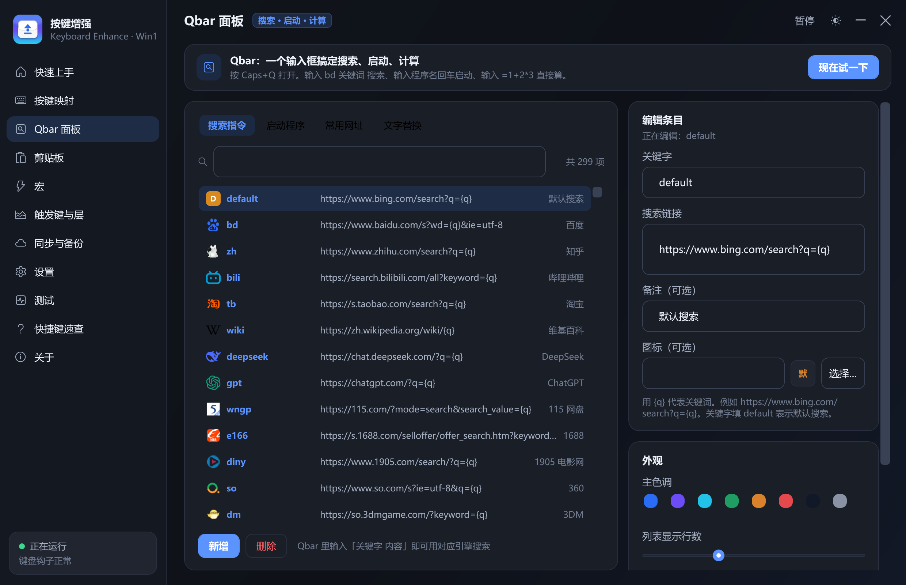
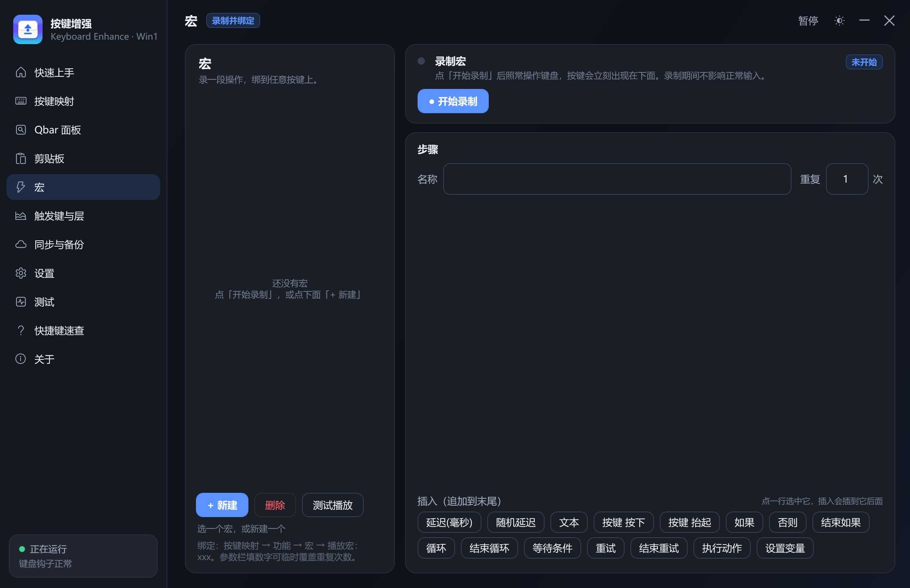
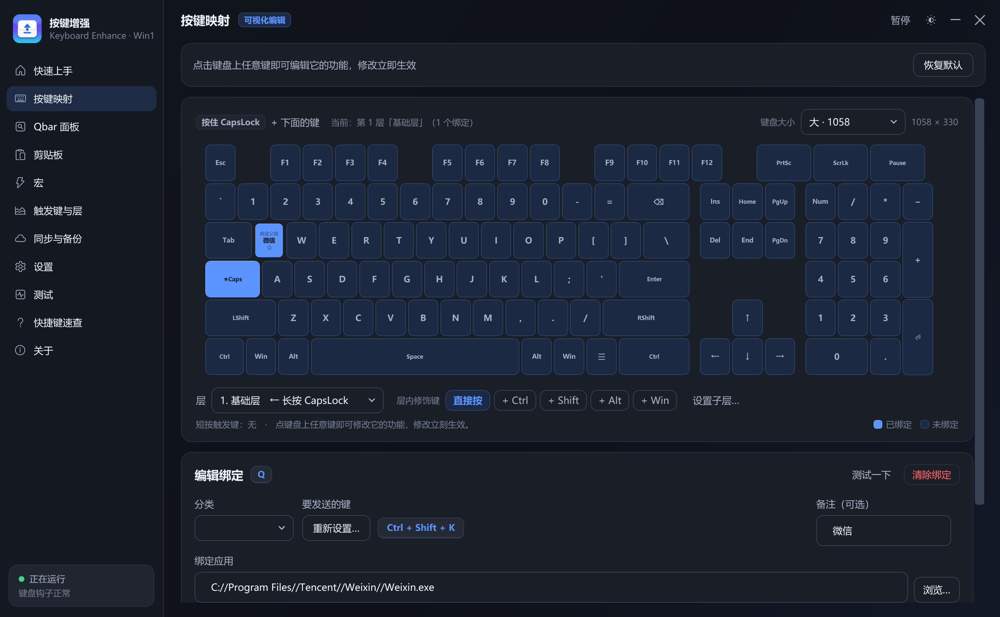

# 按键增强 Keyboard Enhance

> 作者：**QQQOrange**
>
> 把 [wo52616111/capslock-plus](https://github.com/wo52616111/capslock-plus) 的 AutoHotkey 脚本，
> 重写成**原生 Windows 11 桌面程序**：功能一个不少，但所有设置都能在图形界面里点点点完成，
> 再也不用去手改 `CapsLock+settings.ini`。
>
> 运行文件是 **`KeyboardEnhance.exe`**，数据目录是 **`KeyboardEnhance Data`**。

**版本 v4.5.80** ｜ **Windows 10 1809+ / Windows 11（x64 / x86）· Windows 7 SP1（x64 / x86）** ｜ **单文件：Win10+ 约 2.9 MB（依赖 .NET 10 桌面运行时）/ Win7 约 140 MB / 32 位约 130 MB（自带运行时）**

> ### ⚠️ 运行前必须先装 .NET 10 桌面运行时
>
> 本程序**不自带运行时**（所以只有 2.9 MB）。没有它双击**不会有任何反应**，
> 也不会报错 —— 请先装好再启动：
>
> **下载地址**：<https://dotnet.microsoft.com/download/dotnet/10.0>
>
> 在页面里选 **.NET Desktop Runtime 10.0.x → Windows → x64**，下载后一路"下一步"。
>
> 对照检查：`桌面运行时 · Windows · x64`（不是 ASP.NET，也不是 x86）。


---

## 一、这是什么

一句话：**按住 CapsLock，键盘变成另外一副键盘。**

CapsLock 本身几乎是个废键（只有锁定大写一个用途），这个软件把它变成一个"引导键"：
按住它，字母键、数字键、F 区全部变成新功能；松手恢复原样。光标移动、选择文本、
编辑、剪贴板、窗口管理、快速启动、计算、音量亮度……都在这一层里完成。

| 能力 | 概要 |
| --- | --- |
| 按键增强 | Caps 组合键全套语义，**长按连续触发**；10 个键盘层 + 每层 10 个子层 |
| 光标与选择 | 字符 / 单词 / 行 / 页 / 文档五级移动，对应五级选择，一键选中当前行或当前词 |
| 编辑 | 删除整行、删除到行首/行尾、大小写转换、符号包裹选区、撤销/重做交替 |
| 剪贴板 | 两个独立剪贴板的内容、最近复制历史；每条都能**复制到系统剪贴板**（旧版这里写的是「粘贴」，在设置窗口里点它等于往自己身上发 Ctrl+V，什么都不会发生） |
| 窗口 | 置顶、透明度、最小/最大化、关闭、居中、9 种贴边、置底、同程序窗口循环、按屏幕方位激活、**按程序绑定窗口一键切换** |
| 鼠标 | 方向移动（可长按加速）、左右键、滚轮、速度档位 |
| Qbar | 一个输入框搞定搜索 / 启动程序 / 打开网址 / 计算，**299 个内置搜索引擎，298 个带内置图标** |
| 宏 | 录制键盘操作生成可编辑步骤，绑到任意按键；**录制时按键实时显示在屏幕上**，可勾选**固定延迟**让节奏均匀。录不到键时会明确区分「钩子没工作」和「还没敲键盘」，并把钩子/引擎/挂载状态写进日志 |
| 系统功能 | 媒体键、音量、亮度、计算器 / 资源管理器 / 任务管理器、锁屏、截图 |
| 亮度横条 | **与 Windows 11 原版逐像素对齐**（本版重点，见第十一节） |
| 数据安全 | 本地数据 / 备份 / 导出默认 **AES-256-GCM 加密**；WebDAV 同步；GitHub 令牌随备份走 |
| 更新 | 内置自动更新（读 GitHub Releases），下载断线自动重试、SHA-256 校验 |

---

## 二、下载与安装

### 1. 装 .NET 10 桌面运行时（只需一次）

必装项，见上面那条提示。装完后可以在命令行确认：

```
dotnet --list-runtimes | findstr WindowsDesktop
:: 应能看到 Microsoft.WindowsDesktop.App 10.0.x
```

### 2. 选版本下载

到 [Releases](https://github.com/QQQOrange/Keyboard-enhance/releases) 页面下载对应版本，
放到任意目录：

| 你的系统 | 下载哪个 | 运行时要求 |
| --- | --- | --- |
| Windows 11 / Windows 10 1809+，**64 位**（绝大多数电脑） | `KeyboardEnhance.exe` | 需装 .NET 10 桌面运行时（见第 1 步） |
| Windows 10 1809+，**32 位** | `KeyboardEnhance-4.5.80-x86-Win10-Win11.exe` | 需装 .NET 10 桌面运行时（x86） |
| **Windows 7 SP1**，64 位 | `KeyboardEnhance-4.5.80-x64-Win7-SelfContained.exe` | **不用装任何运行时** |
| **Windows 7 SP1**，32 位 | `KeyboardEnhance-4.5.80-x86-Win7-SelfContained.exe` | **不用装任何运行时** |

> 发布页文件名用 `x86 / x64 / Win7 / SelfContained` 标注，是因为 GitHub 会自动把资产文件名里的
> 非字母数字字符（含中文）改写成点号；本地构建产物可以保留中文名，不影响使用。

> **Win7 专用版说明**：.NET 10 官方不支持 Win7（最低 Win10 1809），所以 Win7 版基于
> **.NET 7**（最后一个支持 Win7 SP1 的 .NET）单独构建，运行时打进 exe 里，
> 体积约 140 MB（64 位）/ 约 130 MB（32 位），但拿到机器上双击就能跑。系统必须是 **SP1**。
> Win10/11 专属特性在 Win7 上自动降级：窗口是经典方角（无云母/圆角）、
> DPI 按 system 模式缩放、亮度横条照常工作（WMI 调光不受影响）。
>
> 四条线共用**同一份源码**，差异只在构建目标（详见「十六、开发与构建」）。

运行时会自动在它旁边建两个文件夹：

```
KeyboardEnhance.exe
KeyboardEnhance Data\     用户数据（加密）
KeyboardEnhance Back\     本地备份
```

拷走整个文件夹就带走了软件和全部数据。

> **为什么只有 2.9 MB**：界面框架和 .NET 运行时都由系统里那份提供。
> 代价是你得先装它；好处是程序本体极小、每次更新下载也快。

### 3. 运行

双击 `KeyboardEnhance.exe`：

1. 首次运行会请求管理员权限 —— 这是为了能操作那些"以管理员身份运行"的程序（任务管理器、部分游戏等）。
   如果你不想给，点"否"也能用，只是管不了提权窗口。
2. 会出现三步引导：**选按键方案 → 是否开机自启 → 试一下**。
3. 之后程序常驻托盘（右下角），右键托盘图标可随时打开设置。

> 想彻底退出：右键托盘图标 → 退出。点窗口右上角的 × 只是最小化到托盘。

---

## 三、3 分钟上手

| 想做什么 | 怎么按 |
| --- | --- |
| 光标左移 / 下移 / 上移 / 右移 | `Caps+S` / `Caps+D` / `Caps+E` / `Caps+F` |
| 向左 / 下 / 上 / 右选中 | `Caps+J` / `Caps+K` / `Caps+I` / `Caps+L` |
| 打开搜索面板 | `Caps+Q` |
| 复制到独立剪贴板 | `Caps+C`，粘贴用 `Caps+V` |
| 打开计算器 | `Caps+F2` |
| 切换窗口（先绑定过） | `Caps+1` ~ `Caps+0` |

**长按 `Caps+S` 不松手，光标会连续左移** —— 这是它比方向键更顺手的地方。

---

## 四、核心概念：触发键与层

这一节是理解全部快捷键的钥匙。

**触发键**就是那个"引导键"，默认是 `CapsLock`，但**可以改成任意键**（例如右 Ctrl、
某个不用的 F 键），也可以**同时设置多个触发键**，各自绑定不同的层、各自的
长按阈值和短按动作。在「触发键与层」页管理。

**层**就是"按住触发键时键盘处于第几套映射"，共 **10 层**，每层还可以再挂
最多 **10 个子层**（进入本层后再按住某个键，临时换到另一套映射）。

| 概念 | 说明 |
| --- | --- |
| 层 | 10 层，每层一套完整映射；「按键映射」页顶部可切换当前编辑哪层 |
| 子层 | 每层最多 10 个：层内再按住指定键，临时进入子层映射 |
| 长按阈值 | 按住触发键多久算"进入层"（默认 200 ms），可按触发键分别设置 |
| 短按动作 | 按住不超过阈值时的行为，默认"切换大小写"，可改成 Esc / Qbar / 保持原功能 / 不绑定等 |
| 双击动作 | 快速按两下触发键（默认打开 Qbar），可关 |
| 按键方案 | 内置两套：`capslox`（默认）与 `capslock_plus`（3.0 之前的经典布局），首次运行时选 |

层与触发键全部可视化编辑，改完立即生效，不用重启。

---

## 五、全部快捷键

> 以下为默认方案。所有组合键都可以在「按键映射」页重新绑定，本节只列默认值。

### 光标移动（按住 Caps）

| 按键 | 作用 | 按键 | 作用 |
| --- | --- | --- | --- |
| `Caps+S` | 左移一个字符 | `Caps+D` | 下移一行 |
| `Caps+E` | 上移一行 | `Caps+F` | 右移一个字符 |
| `Caps+A` | 左移一个单词 | `Caps+G` | 右移一个单词 |
| `Caps+P` | 行首 | `Caps+;` | 行尾 |
| `Caps+B` / `Caps+T` | 下移 / 上移 10 行 | `Caps+Enter` | 在行尾换行 |

（还能绑文档开头/结尾、上一页/下一页、页面上/下移一行等，见下节动作表）

### 选择文本

| 按键 | 作用 | 按键 | 作用 |
| --- | --- | --- | --- |
| `Caps+J` / `Caps+L` | 向左 / 向右选中 | `Caps+I` / `Caps+K` | 向上 / 向下选中 |
| `Caps+H` / `Caps+O` | 选中到行首 / 行尾 | `Caps+N` | 向下选中 10 行 |
| `Caps+,` | 选中当前单词 | `Caps+.` | 向右选中一个单词 |

### 编辑

| 按键 | 作用 |
| --- | --- |
| `Caps+R` / `Caps+W` | 删除 / 退格 |
| `Caps+Backspace` | 删除整行 |
| `Caps+[` / `Caps+/` | 删除到行首 / 行尾 |
| `Caps+LAlt+Backspace` | 清空内容 |

### 剪贴板（两个互不干扰的独立剪贴板）

| 按键 | 作用 |
| --- | --- |
| `Caps+C` / `Caps+X` / `Caps+V` | 复制 / 剪切 / 粘贴到剪贴板 1 |
| `Caps+LAlt+C` / `Caps+LAlt+X` / `Caps+LAlt+V` | 剪贴板 2 |
| `Caps+F12` | 开 / 关独立剪贴板 |
| `Caps+F8` | 剪贴板历史 |

独立剪贴板不占用系统剪贴板，所以可以"复制 A、再复制 B，然后分别粘贴"。

### 窗口

| 按键 | 作用 |
| --- | --- |
| `Caps+F6` | 窗口置顶 / 取消 |
| `Caps+F4` | 窗口透明度循环 |
| `Caps+-` | 贴左半屏 |
| `Caps+=` | 贴右半屏 |
| `Caps+1` … `Caps+0` | 默认**空着**：到「按键映射」里把它绑成「窗口绑定 → 某个程序」 |

窗口绑定是「一个键换一个程序」：按一下切过去，再按一次最小化，没开就自动启动
（详见第八节）。数字键默认不绑定，是因为它必须带一个程序参数才有意义。

### 鼠标

| 按键 | 作用 |
| --- | --- |
| `Caps+方向`（可自绑） | 鼠标移动，长按加速 |
| 可自绑 | 鼠标左键 / 右键 / 滚轮上滚 / 下滚 / 速度加减 |

鼠标移动的步长在「设置」里调（默认 10 px/步）。

### 面板与工具

| 按键 | 作用 |
| --- | --- |
| `Caps+Q` | **Qbar**：搜索 / 启动程序 / 打开网址 / 计算 |
| `Caps+Tab` | 把光标前的算式算出结果，或展开热字串 |
| `Caps+F2` | 计算器（带历史记录） |
| `Caps+F3` | （空） |
| `Caps+F5` | 重新加载配置 |
| `Caps+F1` | 打开帮助 |

还有 `Caps+LAlt+方向` 切换窗口、`Caps+LAlt+A~G` 按屏幕方位激活窗口等经典布局快捷键，
详见程序内「快捷键速查」页。

### 系统功能（在「按键映射 → 系统功能」里绑定）

| 功能 | 说明 |
| --- | --- |
| 播放 / 暂停、上一曲、下一曲、停止 | 媒体键，控制当前播放器 |
| 音量 + / 音量 − / 静音 | 发**系统音量键**：Windows 自己调音量并弹出它自己的横条（**不再自绘**，避免一次出现两条）；幅度可在设置里改（默认 5%），也能在「编辑绑定」里给单个键单独设步进；按住连续调节 |
| 亮度 + / 亮度 − | 内置屏走 WMI、外接屏走 DDC/CI（需在显示器菜单开启）；屏幕**底部居中**弹出横条，**样式/大小/位置/图标/动画逐项对齐 Windows 自带的亮度横条**（详见第十一节）；幅度可在设置里改（默认 10%），也能在「编辑绑定」里单独设步进；按住连续调节 |
| 打开计算器 / 文件资源管理器 / 任务管理器 | 常用系统工具 |
| 锁定屏幕 / 截图 | Win+L / 系统截图工具 |

---

## 六、能绑到按键上的全部动作

「按键映射」页的动作下拉按分类组织。**所有分类、所有动作**如下（共 16 类）：

| 分类 | 动作 |
| --- | --- |
| 基础 | 不绑定、切换大小写、保留按键原功能、Esc、回车、Tab、空格、退格、删除、打开设置、启用/暂停 |
| 光标移动 | 左/右/上/下移、左/右移一个单词、行首、行尾、文档开头、文档结尾、上一页、下一页、页面上/下移一行、在行尾换行 |
| 选择 | 向左/右/上/下选中、向左/右选中单词、选中到行首/行尾、选中到文档开头/结尾、选中当前单词、选中当前行、全选 |
| 编辑 | 删除整行、删除到行首/行尾/文档开头/文档结尾、删除前/后一个单词、用符号包裹选区、清空内容、撤销/重做、转大写、转小写、首字母大写 |
| 剪贴板 | 复制/剪切/粘贴到剪贴板 1、复制/剪切/粘贴到剪贴板 2、粘贴系统剪贴板、开关独立剪贴板、剪贴板历史 |
| 面板 | Qbar 快速启动、计算器、Tab 计算 / 热字串、使用帮助、重新加载配置 |
| Qbar 搜索 | 打开 Qbar 并**直接用指定引擎**搜索（常用引擎各一个动作） |
| 直接搜索 | **在默认浏览器里用指定引擎搜索当前选中的文字**，不弹面板（全部 299 个引擎可选，下拉可过滤） |
| 窗口 | **窗口绑定（绑定一个程序：按一下切过去 / 再按最小化 / 没开就启动）**、置顶/取消、透明度切换、最小化、最大化/还原、关闭、居中、贴左/右/上/下半屏、贴左上/右上/左下/右下角、窗口置底、同程序下/上一个窗口、激活左/右/上/下边的窗口 |
| 鼠标 | 鼠标左/右/上/下移、左键、右键、滚轮上滚、滚轮下滚、鼠标速度 + / − |
| 系统功能 | 媒体四键、音量 + / − / 静音、亮度 + / −、打开计算器 / 资源管理器 / 任务管理器、锁定屏幕、截图 |
| 智能直达 | **选中什么就开什么**：选中文字再按这个键 —— 是网址就用浏览器打开，是文件夹就用资源管理器打开，是文件就用默认程序打开（无需预先配置） |
| 直达链接 | 直达网址 / 直达文件夹 / 直达文件：目标**预先填好**，按键照单打开；可写备注，备注显示在键帽上 |
| 自定义按键 | **把某个键发给某个应用**：先确认应用在运行（没运行就先启动），再把键发过去（例如把 F13 转发给微信） |
| 输入文本 | 把一段预设文字直接输入到当前光标处，**逐字符 Unicode 发送，不碰剪贴板**，中文、emoji 都能发，输入法正常 |
| 宏 | 每个宏一个动作：播放宏（共 N 步，约 N ms）+ 打开宏管理 |

> 「按键映射」页点键盘上的任意键，编辑区就在键盘下方，改完立即生效。
> **键盘大小可选四档（小 / 中 / 大 / 特大）**，选一次就是默认。

---

## 七、Qbar：一个输入框搞定大部分事

按 `Caps+Q` 打开。



### 关键字会变成「标签」

输入 `bd` 再按 **空格**，`bd` 就从文字变成一枚标签：

- **有图标 → 显示图标**（例如百度、Google、GitHub，内置矢量图标，离线可用）
- **没有图标 → 显示「名字 + 品牌色首字」**（例如计算器显示橙底「计」）

变成标签后，输入框里只剩**要搜索的内容**，输入完回车即可：

```
[🔵 百度]  天气 预报        →  Enter  →  用百度搜索「天气 预报」
```

- 输入框为空时按 `Backspace`，把标签还原成文字，方便改关键字
- 点标签右边的 `×` 也能移除
- `Tab` 键同样能把关键字变成标签
- 标签模式下仍然支持 `=1+2*3` 直接计算

### 输入规则一览

| 输入 | 结果 |
| --- | --- |
| `bd` + `空格` + `天气` | 变成「百度」标签，搜「天气」 |
| `calc` + `空格` | 变成「计算器」标签，回车启动 |
| `gh` + `空格` | 变成「GitHub」标签，回车打开 |
| `=1+2*3` | 立刻算出 `7`，回车复制到剪贴板 |
| `/settings` | 打开设置 |
| `C:\path\to\file` | 打开该文件 / 文件夹 |
| 任意文字 | 回车用默认搜索引擎搜索 |

`↑` `↓` 选择，`Enter` 执行，`Tab` 补全，`Esc` 关闭。
程序、网址、搜索指令、剪贴板历史、已打开的窗口都会参与匹配。

### 内置命令

| 命令 | 作用 |
| --- | --- |
| `/settings` | 打开设置 |
| `/bindings` | 窗口绑定管理 |
| `/clipboard` | 剪贴板历史 |
| `/help` | 快捷键速查表 |
| `/math` | 计算器 |
| `/reload` | 重新加载配置 |
| `/pause` | 暂停 / 恢复按键增强 |
| `/exit` | 退出程序 |

### 内置引擎（299 个，298 个带内置图标）

关键字按统一约定命名：**国内引擎用拼音首字母，国外引擎用英文前两个字母**。

| 国内引擎（拼音首字母） | 关键字 | | 国外引擎（英文前两字母） | 关键字 |
| --- | --- | --- | --- | --- |
| 百度 | `bd` | | Google | `go` |
| 淘宝 | `tb` | | Bing | `bi` |
| 知乎 | `zh` | | GitHub | `gh` |
| 哔哩哔哩 | `bili` | | Wikipedia | `wi` |
| 微信 | `wx` | | YouTube | `yo` |
| 微博 | `wb` | | Reddit | `re` |
| 京东 | `jd` | | Stack Overflow | `st` |
| 小红书 | `xhs` | | MDN | `md` |
| 抖音 | `dy` | | Amazon | `am` |
| 豆瓣 | `db` | | X (Twitter) | `tw` |
| CSDN | `csdn` | | Facebook | `fa` |
| 掘金 | `juejin` | | npm | `np` |
| Gitee | `gitee` | | NuGet | `nu` |
| 拼多多 | `pdd` | | 翻译 | `tr` |
| 腾讯视频 | `tx` | | | |
| 爱奇艺 | `iqy` | | | |

**第二批补充（共 18 个）**

| 引擎 | 关键字 | 引擎 | 关键字 |
| --- | --- | --- | --- |
| Yahoo | `ya` | DuckDuckGo | `dd` |
| WolframAlpha | `wa` | Google 图片 | `im` |
| Google 地图 | `ma` | Netflix | `ne` |
| Gmail | `gm` | Google 云端硬盘 | `dr` |
| YouTube Music | `mu` | GitHub Gist | `gi` |
| 百度（备用） | `ba` | 搜狗 | `so` |
| Ecosia | `ec` | Brave Search | `br` |
| Spotify | `sp` | Merriam-Webster 词典 | `me` |
| ChatGPT | `ai` | 翻译 | `tr` |

这些引擎也可以直接当命令用，例如 `bd 天气` 立刻用百度搜索。
想加自己的引擎，到「Qbar 面板 → 搜索指令」里新增即可。

> 引擎表自带版本号：每次版本更新新增了内置引擎，启动时会自动把**缺失的**补进你的设置，
> 你自己改过的条目一律保留、不会被覆盖。

### 图标从哪来

按优先级自动取：

1. 你在「Qbar 面板」页给该条目指定的**图标**（png / ico / 任意 exe，或点「选择…」）
2. 程序条目自动使用**该 exe 的图标**（免配置）
3. 都没有 → 显示「名字首字 + 品牌色」的圆角标签

---

## 八、窗口绑定怎么用

**一个键 = 一个程序。** 绑定后按该键：程序没开就**自动启动**，已经开着就**切到前台**，
已经在前台再按一次则**最小化**。

绑定入口在「按键映射」页（没有单独的页面了）：

1. 点键盘上想用的那个键（比如 `1`）；
2. 右侧「分类」选**窗口绑定**，功能选「切换窗口」；
3. 用下面两种方式之一填程序：

**方式一：选择程序文件**
适合"这个键永远对应某个软件"。绑定的是程序本身，哪怕它当前没在运行，按一下也会帮你打开。

**方式二：十字准星点选**
点「点选窗口」后鼠标变成十字准星，去点你想绑定的那个窗口即可 ——
鼠标经过的窗口会实时高亮并显示标题，按 `Esc` 取消。


绑好后键帽上会显示程序图标和名字。`exe` 名不一定是软件名（`idea64.exe` 是 IDEA），
可以在「显示名称」里改成你认得的名字。

> 旧版本的「10 个窗口槽位」（`Caps+1`~`Caps+0` 固定切槽位）已经移除：
> 运行时根本没有调用方，只有自检在调它。现在的窗口绑定不占固定号段，
> 想绑几个绑几个、绑在哪个键上由你决定。

切窗口动画如果不喜欢，到「设置 → 按键行为 → 切换窗口时播放动画」关掉即可。

---

## 九、宏

「宏」页可以**录制键盘操作**（按下哪些键、间隔多久），生成可编辑的步骤，
再绑到任意层的任意按键上。适合重复性录入、游戏连招、固定格式文本的快速输入。

- 录制时按键实时显示在屏幕上，录完可逐步编辑、删除、调间隔
- 每个宏自动出现在「按键映射」的动作列表里（分类：宏）
- 播放时可覆盖重复次数（绑定时填参数）
- **固定延迟**：勾上「固定延迟」并填毫秒数（默认 120），录出来的每个按键之间都用这个值 ——
  适合「点一串按钮」这类操作，回放节奏稳定，也不受手抖影响；不勾则按真实间隔（最小 15 ms）
- 最小步间隔 15 ms
- **远程桌面 / 向日葵 / ToDesk 也能录**：这类工具的按键是注入进来的，低级键盘钩子经常收不到，
  所以录制同时接了 Raw Input 那一路（两路都到的情况按毫秒级去重，不会记成两个键）



---

## 十、文本片段

打字时输入一个**触发词**，立刻替换成一段预置内容。适合邮箱、地址、签名、
常用代码块、工单模板这一类「每次都要重敲一遍」的东西。

到「设置 → 文本片段」添加：填触发词（例如 `;mail`）和展开内容（可多行），点「添加」。

```
输入 ;mail  →  someone@example.com
```

- **触发词必须以符号开头**（`;` `/` `.` 这类），不能是字母或数字 ——
  这样正常打字几乎不可能误触。输入框下面会实时告诉你这个触发词能不能用。
- **必须落在词首**：`my;mail` 不会触发，` ;mail` 会。
- **完全区分大小写**：`;Mail` 和 `;mail` 是两条不同的片段。
- **只在某些程序里展开**：三种填法 —— 直接写进程名（`code.exe, notepad.exe`，逗号分隔，留空 = 全部）、
  点「选择程序…」从文件管理器挑一个 exe、或点「点选窗口」把鼠标变成十字准星去点目标窗口（自动取它的程序名）。
  重复的程序会自动去掉；设置页会实时告诉你当前前台程序在不在这个列表里。
- **「填入示例」**：不知道从哪下手就点它，表单会填好一条可直接用的范例（`;mail → someone@example.com`），改两个字就是自己的了。
- **可以随时停用**：列表里每行前面的勾选框。停用的片段不展开，但配置留着。
- **点列表里任意一行可以改**：内容会载回上面的表单，按钮变成「保存修改」。
- **试算框**：不想真的去敲，就在「试算」框里打一段（例如 `;mail`），
  它立刻告诉你会展开成什么，或者为什么没命中（被程序范围挡住 / 被停用 / 触发词不合法）。

> 关于「短触发词抢长触发词」：同时配了 `;m` 和 `;mail` 时，缓冲一到 `;m` 就命中，
> `;mail` 就永远轮不到 —— 这是这类功能的老问题。现在命中时会先看有没有更长的候选，
> 有就等 **120ms**：你接着打 `a` 就自动让位给 `;mail`，不打就按 `;m` 展开。

---

## 十一、系统功能：音量横条与亮度横条

### 音量

按绑定的音量键时，本软件发的是**系统音量键**（`VK_VOLUME_UP/DOWN`）——
Windows 自己调音量、自己弹它自己那条横条。**不自己画**，因为自绘永远做不像，
还会一次出现两条。步进默认 5%，可在「设置」里改，也可以给单个键单独设。

### 亮度（v4.5.23 起与 Win11 原版逐像素对齐；v4.5.24 起自绘太阳）

内置屏走 WMI、外接屏走 DDC/CI（需在显示器菜单开启）。屏幕**底部居中**弹出横条。
卡片 / 进度条 / 数字 / 位置按 Windows 11 原版逐像素量过（3200×2000 @200%）：

| 项目 | 系统实测 | 本版 |
| --- | --- | --- |
| 卡片 | 384×94 px = **192×47 DIP**，圆角 7.5 | 同 |
| 位置 | 水平居中，**贴工作区**底边 14 DIP | 同（不用任务栏上沿当基准） |
| 进度条 | 110×4 DIP 胶囊，起点 42.0 | 同 |
| 数字 | 右缘 179.0 DIP，**Segoe UI Variable Display** | 同 |
| 配色 | 白天浅色、夜间深色，跟 Windows 主题走 | 同 |

所有尺寸/位置/版式常量集中在 `Core/Windows/OsdPlacement.cs` 一处，用 DIP 定义、
按目标显示器的缩放换算 —— 换任何分辨率/缩放都按同一比例走（自检里穷举了
1366×768@100% ~ 3840×2160@200% 及负坐标副屏）。

**v4.5.24 起图标改成自绘太阳**（不再用系统字形）；**v4.5.25 起几何完全照原版重画**：

| 项目 | 行为 |
| --- | --- |
| 中心环 | **空心圆环**（描边，不是实心盘）：墨迹外径 8.0 / 内径 6.0 DIP，任何亮度下都不变 |
| 放射线 | 8 根胶囊状射线，**离圆环 2.0 DIP**；内端固定、外端 7.4 → 8.0 DIP 线性伸缩 |
| 环线分离 | 间隙恒为 2.0 DIP —— 任何亮度下都不会连成一团 |
| 旋转 | 亮度变化时整组射线绕圆心旋转，转角 = 360°×进度 —— 变化快就转得快，停稳即静止 |
| 颜色 | 跟随文字色（夜间纯白 / 日间近黑），单色、无光晕 |

几何是按 Windows 11 原版图标（Segoe Fluent Icons **E706**）量出来的：把字形按 1024 em
超采样渲染，从圆心沿半径扫亮段得到 em 千分比，再按墨迹直径 16 DIP 换算成
环 8.0 / 6.0、线宽 1.0、射线 6.0→8.0、间隙 2.0 —— 全是整数。

真机验证（3200×2000 @200%）：100% 墨迹正好 32×32 px（16.00 DIP）、环外径 7.5~8.0、
射线内端 6.00 外端 7.95、间隙恒 > 2 DIP；30% 档墨迹收到 14 DIP 时圆环尺寸与间隙不变。

亮度步进默认 10%，可改；按住连续调节时横条会平滑爬升，按得越久每步越大
（约 0.7 秒到满速 2.5 倍）。

---

## 十二、界面

| 页面 | 用途 |
| --- | --- |
| 快速上手 | 运行状态、按键方案、三步引导 |
| 按键映射 | **点键盘上的任意键**，编辑区就在键盘下方，改完立即生效；**键盘大小可选四档（小 / 中 / 大 / 特大）**，选一次就是默认，也是这个页面的最小尺寸。可切基础层 / LAlt 层 / Win 层；分类里还有「直达链接」，可以预填网址 / 文件夹 / 文件一键直达；「智能直达」分类则是**选中什么就开什么**（不用预先配置）；「自定义按键」可以指定「把某个键发给某个应用」，应用没在跑会先拉起来。右上「恢复默认」有二次确认，不会误触清掉自定义绑定 |
| Qbar 面板 | 搜索指令、启动程序、常用网址、文字替换、外观与图标 |
| 剪贴板 | 两个独立剪贴板的内容、最近复制历史 |
| 宏 | 录制键盘操作生成可编辑步骤，绑到任意按键；**录制时按键实时显示在屏幕上** |
| 触发键与层 | 触发键（可多个）、长按阈值、短按动作、10 层的名称与启用状态、每层子层 |
| 同步与备份 | WebDAV 同步（启动 / 退出 / 自动备份三个开关）、备份列表恢复（覆盖或合并）、导入导出；备份与导出默认加密，勾了哪组就带走那组的全部字段。**GitHub 令牌随加密备份 / 同步走**，换台机器恢复后不用重新填（合并时本机已有的令牌不会被覆盖） |
| 设置 | 开机自启、托盘、短按行为、双击行为、长按连发、切窗口动画、按键反馈、鼠标速度与步长、音量/亮度步进、主题、**界面语言（简体中文 / English，切换立即生效，不用重启）**、**启动密码保护**、**文本片段**（见第十节，程序范围可「选择程序…」或十字准星点选） |
| 测试 | 实时显示钩子状态、当前层、最近按键与命中动作，可复制诊断信息 |
| 快捷键速查 | 按分类列出当前生效的全部组合键，支持筛选（由当前配置实时生成） |
| 关于 | 版本号、GitHub 链接、自动更新开关、检查更新 |

界面支持**浅色 / 深色 / 跟随系统**，右上角一键切换；窗口使用 Win11 圆角与云母材质。



### 出问题先看「测试」页

设置里的 **「测试」** 页会实时显示：键盘钩子是否正常、触发键有没有被识别、
当前在第几层、刚按下的键在那一层会执行什么动作，还能一键复制诊断信息。
按了键没反应时，先看这一页 —— 是钩子没收到键、还是层没切过去、还是动作本身失败，
一眼就能分清。

---

## 十三、数据、备份、同步与迁移

### 数据在哪

| 内容 | 位置 |
| --- | --- |
| 用户数据 | `KeyboardEnhance Data\settings.json`（加密）、`vault.json`、`icons\`、`logs\` |
| 本地备份 | `KeyboardEnhance Back\KeyboardEnhance(时间).keyboardenhance` |

装到 `Program Files` 这类不可写位置时，数据会自动回落到
`%LocalAppData%\KeyboardEnhance`（「同步与备份」页会明确标出来）。
老版本留在 `%LocalAppData%\CapsLockPlus` 的数据会在第一次启动时自动搬过来，原目录保留不删。

### 备份与同步

- **本地备份**：默认保留最近 10 份，可自动备份（默认 60 分钟一次），可一键恢复（覆盖或合并）
- **WebDAV 同步**：填一个 WebDAV 地址即可在启动时 / 退出时 / 定时同步，三台开关独立控制
- **导入导出**：导出 `.clpconf`；`.keyboardenhance` 备份文件现在也能直接导入
- **加密**：备份与导出默认 **AES-256-GCM** 密文；只有显式选「明文导出」时才剔除密码类字段与 GitHub 令牌
- **GitHub 令牌**：随加密备份 / 同步一起走，换机器恢复后不用重新填

### 启动密码（软件的前门，与备份密码完全独立）

「设置 → 启动密码保护」是一个独立开关，和「同步与备份」页的**备份密码完全不是
一回事**——那一个管备份文件与本地数据加密，这一个只决定**谁能打开这个软件**：

- **开启**：弹「设置启动密码」（新密码 + 输两遍确认），设完即生效；
- **关闭 / 修改**：都要先验证当前密码，证明了才继续；
- 开启后每次启动软件，先弹密码窗：**密码正确 → 进入主界面；错误或取消 → 直接退出**
  （连键盘钩子都不会装上，热键也不工作）。

| | 启动密码 | 备份密码 |
| --- | --- | --- |
| 管什么 | 谁能打开这个软件 | 备份文件 + 本地数据加密 |
| 设在哪 | 设置页开关 | 同步与备份页 |
| 存在哪 | 数据目录 `startup.json` | 设置里（随数据一起加密） |
| 忘了怎么办 | 删掉 `KeyboardEnhance Data\startup.json` 即解除保护，其他设置不受影响 | 备份解不开 |

安全细节：磁盘上只有 PBKDF2-HMAC-SHA256 派生值（600,000 次迭代、随机盐），
**不存明文**；密码文件独立于 settings.json，备份密码解锁失败时这道门照样生效；
密码不随导出/备份搬家（明文导出会剔除整组字段），换机器要设新的；
「重置全部设置」不影响启动密码。

### 从旧版 CapsLock+ 迁移

「设置 → 从旧版 CapsLock+ 导入设置」，选择旧的 `CapsLock+settings.ini`：

- `[Keys]` 里的 `keyFunc_xxx(参数)` 会映射成新版的「动作 + 参数」
- `[QSearch]` / `[QRun]` / `[QWeb]` / `[TabHotString]` 全部导入
- `autostart`、`mouseSpeed`、`allowClipboard` 一并迁移
- 少数无法自动映射的（例如自定义 `keyFunc_doubleChar` 的包裹字符）会在导入结果里列出，需手动确认

---

## 十四、更新

「关于」页有两个入口：

**自动更新（开关）**
勾选后，每次启动会在后台静默检查（同一台机器一天最多一次）。发现新版本会弹出提示，
问你是否下载；点「下载并安装」后**就在当前窗口下载**，完成后自动替换旧程序并重启。
不想装某个版本，点「跳过此版本」，之后再出新版仍会提醒。

**检查更新（按钮）**
立刻检查一次，有新版本会显示版本号、体积和更新说明。

流程：下载到数据目录 → 校验 SHA-256（发布方提供时）→ 旧程序改名 → 新程序就位 →
启动新版本。旧文件会在下次启动时自动清理。
下载用独立客户端（5 分钟超时 + 最多 3 次重试），弱网也不会再"转几秒就失败"。

> 开发提示：本项目的自动更新读取 GitHub Releases 的 latest。发布新版本时把 tag 写成
> `v4.5.24` 这种形式，并附上 `.exe` 资产，更新功能即可正常工作。

---

## 十五、和上游的差异

**保留**：Caps 组合键的全部语义、两套按键方案、Qbar 的搜索/启动/计算、独立剪贴板、
窗口绑定、Tab 计算与热字串。

| 方面 | 上游（AutoHotkey） | 本版本 |
| --- | --- | --- |
| 配置方式 | 手改 UTF-16 的 ini | 图形界面 + JSON，改完即时生效 |
| 计算能力 | 依赖 IE 引擎跑 JS | 自带表达式解析器，Win11 无 IE 也能算 |
| 钩子稳定性 | 长时间运行后可能被系统摘掉 | 每秒巡检，异常自动重装 |
| 按键延迟 | 钩子里直接跑功能 | 钩子只做判断，功能入队执行，不会被系统摘钩 |
| 剪贴板监听 | 定时器轮询 | `WM_CLIPBOARDUPDATE` 消息驱动，空闲零 CPU |
| 搜索关键字 | 纯文本缩写 | 带图标的标签 |
| 更新 | 手动下载 | 内置自动更新 |
| 隐私 | 明文 ini | 本地数据、备份、导出默认全部 AES-256-GCM 密文；只有显式选「明文导出」时才剔除密码类字段与 GitHub 令牌 |
| 排错 | 看日志猜 | 「测试」页实时显示按键、层、动作 |
| 启动速度 | — | 首屏约 0.6 秒 |

---

## 十六、常见问题

**按住 Caps 没反应？**
检查托盘图标是否存在、设置页「运行状态」是否为「已启用」。若显示「键盘钩子未生效」，
点一下「暂停」再「恢复」即可重装钩子。

**Caps+Q 打不开 Qbar / 某些环境里热键整体失灵？**
先看「测试」页顶部的钩子状态，再跑一次 `KeyboardEnhance.exe --diag`。
最常见的两个原因：

- **远程桌面 / 向日葵 / ToDesk**：这类工具的按键是**注入事件**，低级键盘钩子排在别人后面时会被吞掉，
  于是所有热键一起失灵（4.5.60 之前宏录制就是这么"收不到键"的）。从 4.5.62 起，钩子连续
  5 秒收不到任何按键时，热键会自动改由 Raw Input 触发，日志里会出现一条
  `键盘钩子已经 5 秒没收到任何按键，改由 Raw Input 触发热键`；钩子一恢复就自动交还。
- **钩子被安全软件拦掉**：`--diag` 会给出 11 项结论；必要时把程序加入杀软白名单，
  或让程序与目标程序以相同权限运行（都是普通权限，或都是管理员）。

Qbar 本身打不开的另一种情况（窗口被关掉后无法复用）也已经修掉：现在关掉就重建，
失败会写日志并再试一次，不会静默什么都不弹。

**长按触发键却一直输出这个键（比如 Tab 一直跳焦点）？**
这不是触发键的逻辑坏了（引擎那边每一次按下、包括系统自动重复都会被吞掉，自检里有 5 条断言钉着），
而是**钩子不在链上**：钩子收不到键时，程序会切到 Raw Input 兜底 —— 热键**能触发**，但**吞不掉**按键，
于是层切过去了、Tab 还在往前台送。

**4.5.65 的两个根因（长按触发键一直输出原键的真正原因）：**

1. **日志拖住了钩子回调**。日志每写一行都 flush 到磁盘，而钩子回调里也会写日志。
   磁盘一慢（同时开云同步 / 自动备份 / 安全软件在扫），回调就卡在 flush 上；
   低级钩子回调超过 300ms 系统会**丢弃这次输入并摘掉钩子**。
   现在日志改成**异步写**：调用方只入队，后台线程写盘，按键路径永不碰磁盘。
2. **选区监听装了第二个低级键盘钩子**。钩子是串行的，它排在主钩子前面，
   它一慢，主钩子连回调都进不去 —— 于是热键全失灵。
   现在它**不再装钩子**，改用已有的 Raw Input 通道识别 Ctrl+C。

4.5.64 起程序还会自己救：

1. 每 10 秒（启动后 10 秒开始、之后每 60 秒）给自己发一个**不带标记的 F24** 探钩子；
2. 探不到就重装钩子，装回来会写 `重装后自检通过，钩子已恢复`；
3. 重装也救不回来，就**自动重启自己**（新进程的钩子通常是好的），日志里有
   `键盘钩子已失效且无法在进程内恢复，自动重启程序以恢复`；
4. 注入按键本身被系统拒绝时（前台是管理员窗口，UIPI 会拦 SendInput），只写
   `钩子自检无法进行（…）：注入按键被系统拒绝` —— 这种情况**不会**误判成钩子坏了。

**把 Tab 设成触发键，长按却一直输出 Tab？**
这是钩子不在链上的连带症状：钩子收不到键时，程序会切到 Raw Input 兜底 ——
热键**能触发**，但**吞不掉**按键，于是层切过去了、Tab 还在往前台送。
从 4.5.63 起程序会**自己给自己发一个 F24** 探钩子（启动 3 秒后、之后每 60 秒），
收不到就重装；兜底一启用也会先重装一次。连续三次都装不上会弹提示并写日志
（`钩子自检失败…正在重装`），这时请把本程序加入安全软件白名单，或重启程序。

**某些程序里组合键不生效？**
以管理员身份运行的程序（任务管理器、部分游戏）需要本程序也提权。
启动时同意 UAC 即可；也可以到「设置 → 运行权限」点「以管理员身份重启」。

**锁屏（Win+L）之后快捷键还能用吗？**
**不能，这是 Windows 的设计限制，任何用户态程序都做不到**，包括管理员权限
和带 `uiAccess` 签名的程序。

原因：锁屏会切到一个独立的 **Winlogon 安全桌面**，微软禁止普通进程在那个
桌面上安装键盘钩子或注入输入 —— 否则任何软件都能在你锁屏后模拟按键解锁，
安全模型就失效了。`Ctrl+Alt+Del` 同理（SAS 序列，用户态拦不住）。

如果你的目标是「锁屏后快速回到桌面」，可行替代方案是用 Windows 自带的
Windows Hello（指纹/PIN）或设置一个短的无操作自动锁定时间。
本项目不会尝试绕过这个限制。

**Caps 不能切换大小写了？**
短按 Caps 默认就是切换大小写。如果被改成了「什么都不做」，到「设置 → 按键行为」改回来。

**想彻底退出？**
右键托盘图标 → 退出。若「设置 → 关闭窗口时最小化到托盘」是开着的，点 × 只是隐藏窗口；
把它关掉后点 × 就是真的退出程序（钩子、托盘一起收掉）。以前关掉这个开关点 ×，
窗口会消失但程序还在后台接管键盘 —— 现已修正。

**宏录制点了「开始录制」，敲键盘却一个都不显示？**
说明键盘事件没进来。看两个地方：
① 「测试」页顶部的钩子状态；② 数据目录 `logs\app.log` 里这两行 ——
`宏录制开始：钩子=正常/失效 …` 和 `宏录制结束：录制到 N 个事件，钩子期间累计增加 M 个`。
`M` 是钩子这期间实际收到的按键数：`M > 0` 而 `N = 0` 是事件没进录制器，`M = 0` 是钩子压根没收到键
（多为安全软件拦截，或程序没有以管理员身份运行）。也可以直接跑一次
`KeyboardEnhance.exe --diag`，它会给出 11 项结论。

**用远程桌面（向日葵 / ToDesk / RDP）时钩子收不到键是正常的**：这类工具的按键是注入的，
排队到钩子这一层经常被前面的钩子挡掉。从 4.5.60 起录制会**同时**读 Raw Input，
日志里会写成"Raw Input 补录"；此时 `钩子 0 / Raw Input 补录 N` 是正常现象，宏照常生成。

**文本片段打了触发词没展开？**
到「设置 → 文本片段」的**试算框**里打同样的内容，它会直接说原因：触发词不在词首、
区分大小写、被「只在某些程序里展开」挡住、或者这条片段被停用了。

**数据和备份在哪？**
都在软件旁边，拷走整个文件夹就带走了软件和全部数据（见第十三节）。

**提示找不到 .NET？**
说明还没装运行时，回到上面「二、下载与安装」的第 1 步。

---

## 十七、开发与构建

需要 **.NET 10 SDK**。详细说明见 [BUILD.md](BUILD.md)。

```powershell
# 用法总览（自检 / 诊断 / 出图 / 界面，全部开关都在这里）
dist\KeyboardEnhance.exe --help

# 自检：2862 项，覆盖按键模型、表达式、Qbar、标签、迁移、钩子、组合键状态机、
# 横条比例穷举、界面多语言、片段匹配、浮层定位、关闭行为
dist\KeyboardEnhance.exe --selftest

# 诊断：全局钩子链路（会自动注入一个 F24 自检 6/6，不用你手工敲键）
dist\KeyboardEnhance.exe --diag

# 诊断：钩子到底能不能收到按键（只装钩子、自己敲两下，结果会弹窗）
Start-Process "dist\KeyboardEnhance.exe" -ArgumentList "--hooktest" -Wait

# 诊断：把解密后的触发键/层配置打出来（结果会弹窗，同时写 logs\triggers.txt）
Start-Process "dist\KeyboardEnhance.exe" -ArgumentList "--dump-triggers" -Wait

# 注意：本程序是窗口型程序，直接 `& KeyboardEnhance.exe --hooktest` 时 PowerShell 不会等待、
# 也没有控制台可显示，看起来像“一点反应都没有”。用 Start-Process -Wait，或看弹窗。

# 硬件联调：音量 / 系统音量键 / 亮度，跑完自动还原
dist\KeyboardEnhance.exe --hwtest

# 离屏渲染全部界面（文档/回归用，不受桌面遮挡与 DPI 影响；共 39 张）
dist\KeyboardEnhance.exe --render docs\screenshots
```

**全部命令行开关**

| 开关 | 作用 |
| --- | --- |
| `--selftest` | 跑自检（退出码 0 = 全过），日志写到数据目录的 `selftest.log` |
| `--render <目录>` | 离屏渲染所有界面为 PNG |
| `--render-diag` | 渲染时附带布局指标与「未翻译文案」审计 |
| `--diag` | 钩子链路诊断（自注入验证 + 11 项状态） |
| `--hwtest` | 硬件联调：音量、系统音量键、亮度（结束后还原） |
| `--osd [百分比]` | 直接弹一次横条（不带参数 = 走一遍音量再还原） |
| `--osd-hold <毫秒>` | 横条停留时间 |
| `--pick-test <文件>` | 提权状态下的窗口点选测试 |
| `--page=<名字>` | 启动到指定页面（`guide` `keys` `qbar` `clipboard` `macros` `layers` `backup` `settings` `test` `help` `about`） |
| `--trace` | 把钩子收到的每个按键写进日志 |
| `--svg2png` | 把内置 SVG 渲染结果另存为 PNG（图标资源回归用） |
| `--help` | 打印上面这张表（WinExe 没有自己的控制台，会先 AttachConsole，并把用法写进数据目录 `usage.txt`） |

> csproj 用 `<TargetFrameworks>net10.0-windows;net7.0-windows</TargetFrameworks>` 多目标，
> 两条线共用同一份源码：net7 线的 LangVersion 锁 C# 11、换 System.Management 8.0.0、
> 用 `app-win7.manifest`（补 Win7 supportedOS GUID、去掉 PerMonitorV2）。
> 少数 .NET 8+ 的便利 API（`JsonNode.DeepClone`、`AesGcm(byte[],int)`、
> `OpenFolderDialog`）已统一改成两条线都能编译的等价写法，行为不走条件编译、
> 永远一致。

```powershell
# 自检（2862 项，覆盖按键模型、表达式、Qbar、标签、迁移、钩子、组合键状态机、横条比例穷举、界面多语言、片段匹配、浮层定位、关闭行为）
dist\KeyboardEnhance.exe --selftest

# 离屏渲染所有界面（文档/回归用，不受桌面遮挡与 DPI 影响）
dist\KeyboardEnhance.exe --render docs\screenshots
```

**代码结构**

```
src/CapsLockPlus/
├─ Core/                  与界面无关的核心逻辑（可无界面自检）
│  ├─ Input/              键盘钩子、Caps 组合键状态机、按键名映射、输入注入
│  ├─ Actions/            动作目录、动作上下文、剪贴板、窗口绑定
│  ├─ Windows/            窗口枚举 / 激活 / 贴边 / 置顶 / 透明度、音量、亮度、横条版式
│  ├─ Text/               选区读写、表达式求值
│  ├─ Qbar/               Qbar 检索与标签（Chip）
│  ├─ Icons/              图标缓存、极简 SVG 渲染器
│  ├─ Macro/              宏录制与回放
│  ├─ Settings/           JSON 设置、旧版 ini 迁移、开机自启
│  ├─ Sync/               WebDAV、加解密、导入导出、备份合并
│  └─ Update/             检查 / 下载 / 替换更新
├─ UI/                    WPF 界面
│  ├─ Windows/            主窗口、Qbar、计算器、引导、Toast、更新提示、亮度横条
│  ├─ Views/              12 个页面
│  ├─ Theme/              主题、Win11 窗口外观
│  └─ AppHost.cs          装配中心：引擎 + 托盘 + 窗口
├─ Theme/                 浅色/深色调色板与控件模板
└─ SelfTest.cs            自检
```

**设计要点**

- 钩子回调里**只做判断**，功能全部投递到 `ActionQueue` 的工作线程执行，
  避免超过系统 300ms 超时被摘钩
- 注入的按键带 `dwExtraInfo` 标记，钩子据此忽略自己发出的按键，不会自我触发
- 页面按需创建（`ContentControl` + 字典缓存），启动时只构建当前页
- 刻意不使用 `DropShadowEffect`：WPF 的阴影会把内容渲染到中间位图，既占内存又让文字发虚
- 主题色一律用 `DynamicResource`，切换深浅色时已打开的窗口会立即跟着变
- 新增一个动作只需在 `Core/Actions/ActionCatalog.cs` 里加一行，
  按键映射页与快捷键速查页会自动出现它

---

## 十八、性能

| 指标 | 实测 |
| --- | --- |
| 首屏时间 | 约 0.6 s |
| 空闲 CPU | 0 % |
| 托盘常驻内存 | 私有约 60 MB |
| 可执行文件 | 2.9 MB（单文件、框架依赖） |
| 自检 | 2181 项全部通过 |

### 钩子热路径的优化

键盘钩子回调有 **300ms 硬超时**（`LowLevelHooksTimeout`），超时后系统会
**静默卸载钩子**且不通知 —— 表现为"用着用着快捷键全部失效"。
所以回调路径上的每一纳秒都值得省：

| 位置 | 优化前 | 优化后 |
| --- | --- | --- |
| 判断是否触发键 | 每次按键遍历 Triggers，逐个做 `VkOf()` 字符串→字典查找 | 缓存成 `HashSet<int>`，一次整数查找（用键名指纹失效） |
| 查层内绑定 | 两次 LINQ 线性扫描 + 大小写不敏感逐字符比较 | 预建 `Dictionary`（大小写不敏感），O(1) |
| 层内按键 | 每次重新分配 `List` | 复用缓存字典 |

这三处都在"每按一个键都要跑一次"的路径上，第 1 层通常有上百条绑定，
优化前的累积开销在低配机器上确实有顶到超时的风险。

---

## 十九、许可

上游 Capslock+ 采用 GPL-3.0，本项目作为其衍生作品同样遵循 **GPL-3.0**，
详见 [LICENSE](LICENSE)。上游源码保留在 `upstream/` 目录以便对照。
